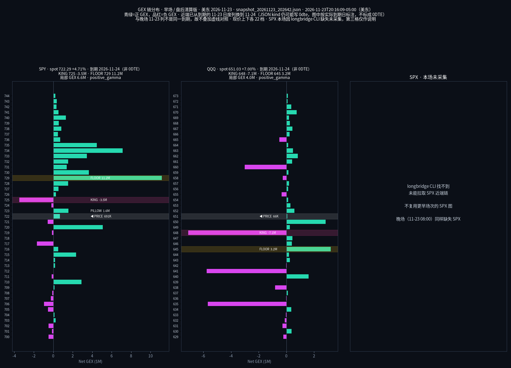
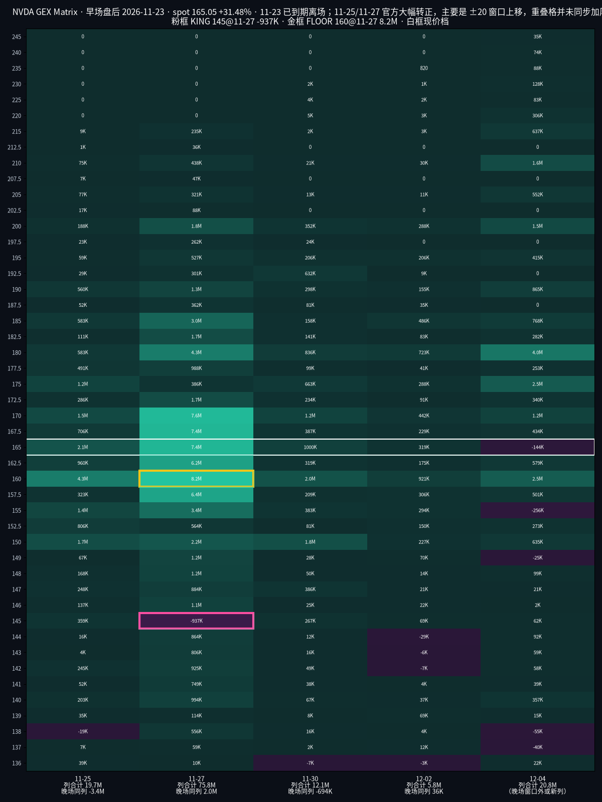
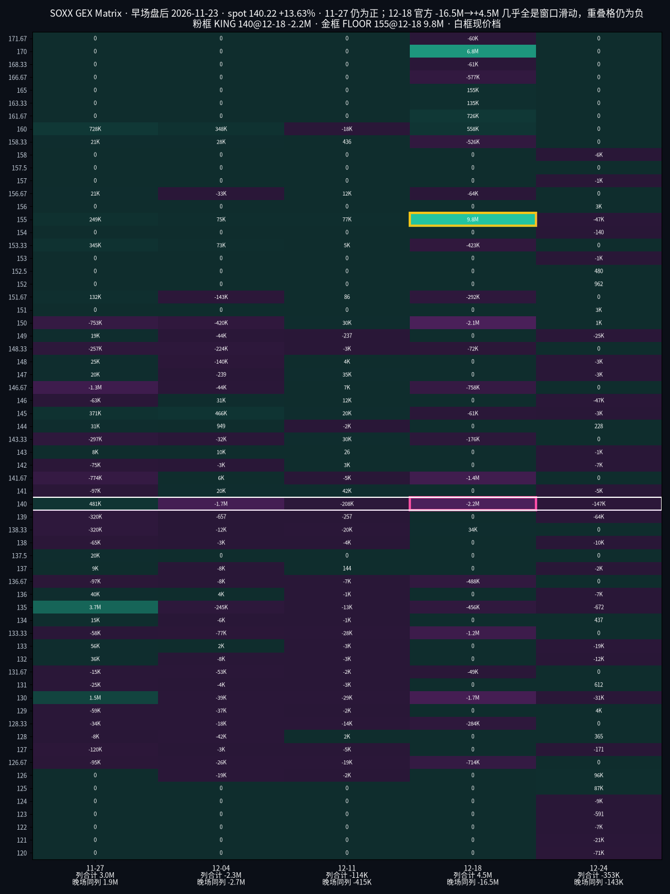
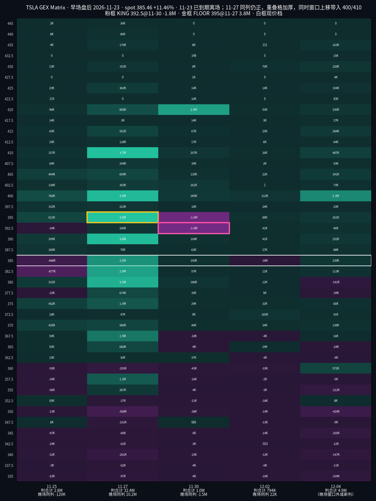
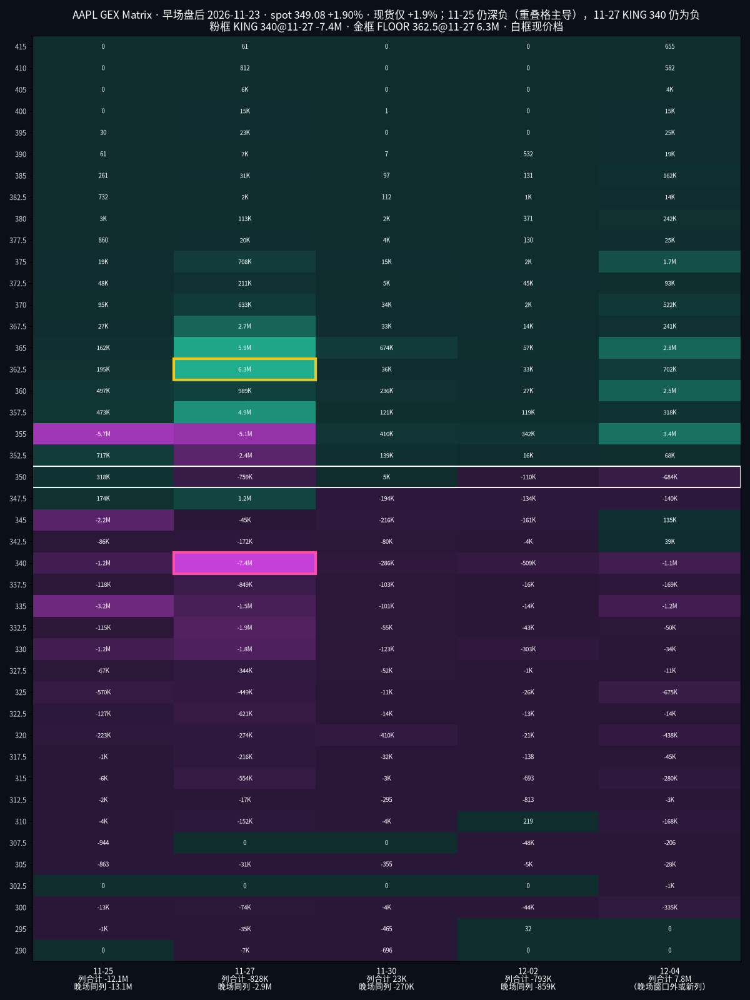

# GEX 早场（盘后清算版）日分析 · 美东交易日 2026-11-23（周一）20:15

**结论先行**
- 本场是周一收盘后的第一份快照。现货大幅反弹：SPY **689.81→722.29（+4.71%）**，QQQ **608.45→651.03（+7.00%）**。指数近端已从到期的 **11-23** 日度列换到 **11-24**（JSON kind 仍写 `0dte`，按实际到期日标注，**不标成周一 0DTE**）。晚场 11-23 列上那些很大的正墙（SPY FLOOR **705 +25.4M**，以及 700/710/715）已随到期离场，**不能把新列的局部翻正或体制标签，读成同一列的持仓变化或风险下降**。
- `oi_inventory=prior_close_t1`（`oi_as_of=yesterday_close`）。本场看到的仍是**周五清算 OI**，按周一收盘价和更近到期的 gamma/IV 重定价，再叠上矩阵 ±20 档窗口随现货大幅上移。周一盘中新开的仓，要等周二 08:00、且 11-24 变成当日到期的那一份，才是第一份带周一清算 OI 的链。
- **SPY** 新 11-24 列：局部 **+6.6M**，官方体制 **正 gamma**。可见列 697–747，正值 **+55.3M** / 负值 **-10.0M** / 净 **+45.2M**（36 档为正、15 档为负）。FLOOR **729 +11.2M**，上方 734 +7.1M、735 +4.5M 成堆；现价下方 720 +5.1M。但现价上方两档的 KING **725 -3.5M** 是明显负口袋，不能只看体制标签。
- **QQQ** 官方也标了正 gamma、局部 **+4.0M**，但可见列净额仍是 **-7.8M**（正 +16.4M / 负 -24.2M）。KING **648 -7.1M** 就在收盘价下方约 3 点，下方还有 641 -5.8M、635 -5.7M，上方 660 -3.0M。官方 FLOOR **645 +3.2M** 在现价以下，体量小于这块负 KING。**不要把官方体制翻正当成近端已经转正。**
- **SPX 本场再次缺失**，错误仍是「找不到 longbridge CLI」。本场拉链跑在 `win-host`。矩阵 29/29、SPY/QQQ 各 102/102 完整，`collection.ok=false` 只因 SPX。不复用更早场次的 SPX 图。
- 自动摘要把 NBIS / CRWV / SOXL / LITE / META / SPCX 标成「强力翻正」。复核后：**META、SPCX 是近端到期切换**（11-23 负列离场，新 11-25 只有几十万级薄正，且窗口贡献大）；**NVDA、MU、SOXX 的 12-18、LITE** 官方变号或大幅转正，几乎是 ±20 窗口上移，重叠格并未同步翻正；**SOXL 11-27** 重叠格确实由接近零翻到 +2.6M（50 档加厚），但 12-18 仍负约 -2.2M。AAPL / MSFT 现货只涨约 2%，近端仍为负，且 MSFT 11-27 KING 490 还在加深。

## 1) 数据与新鲜度
- 场次：早场 / 盘后清算版。目标时刻美东 2026-11-23 20:15（北京 2026-11-24 09:15）。
- 读取文件：仓库 `wikiTang-code/whop-wechat-bridge` 分支 `feat/chg064-offline` 的 `data/gex/20261123/snapshot_20261123_202642.json`（目录内 `latest.json` 与该快照一致；归档以当日目录为准）。
- 生成时间 `generated_at`：**2026-11-23T20:16:09-05:00**（北京 2026-11-24 09:16:09）。拉链 20:16:05 ET 开始，**20:26:42 ET** 完成，截止 20:40、完成窗口 20:35–20:40，`deadline_status=on_time`，`spot_session=closed_or_extended`，`oi_inventory=prior_close_t1`。归档推送时间为北京 **09:26**（提交 `449d136`）。相对本场目标时刻，快照新鲜、按时。
- 采集：富途 OpenD `us_option=LV1`，主机标记 `win-host`。SPY/QQQ 各 102/102，矩阵 29/29。SPX 失败：`找不到 longbridge CLI`（与本周一晚场相同；11-19 曾在 Bot 电脑重装并验证，但本场拉链不在那台机器上跑）。不把 `collection.ok=false` 当成总失败，只标明 SPX 缺席。
- 对照：同一美东交易日晚场 `data/gex/20261123/snapshot_20261123_081030.json`（`generated_at` 2026-11-23T08:00:00-05:00，北京 21:00:00）。当时现货仍是周五收盘，11-23 为 0DTE，是第一份带周五清算 OI 的链。本场现货已是周一收盘，近端换到 11-24，差异里混有到期离场、窗口滑动和重定价，**不是周一清算 OI 的对照**。

## 2) 指数近端（到期 2026-11-24，已换日；不是周一 0DTE）

| 标的 | 现货 | KING | FLOOR | 局部 GEX | 可见列合计（正/负/净） | 体制 |
|---|---|---|---|---|---|---|
| SPY | **722.29（+4.71%）** | **725 -3.5M**（晚场为 695 -9.4M，但是 11-23 列，已离场） | **729 +11.2M**（晚场 705 +25.4M 已随 11-23 离场） | **+6.6M**（晚场 -13.1M，不同列） | 正 **+55.3M** / 负 **-10.0M** / 净 **+45.2M**（51 档，697–747；36 正 / 15 负） | 官方正 gamma |
| QQQ | **651.03（+7.00%）** | **648 -7.1M**（晚场 600 -5.2M，已离场） | **645 +3.2M**（在现价下方；晚场 628 +4.3M 已离场） | **+4.0M**（晚场 -6.7M，不同列） | 正 **+16.4M** / 负 **-24.2M** / 净 **-7.8M**（51 档，626–676；35 正 / 16 负） | 官方正 gamma，但整链仍净负 |
| SPX | 本场缺失 | — | — | — | 晚场同样缺失，没有可对照的周一链 | — |

换日说明（不是持仓对照）：
- SPY 晚场 11-23 列正值曾达 +84.4M、净 +28.2M，最大正墙 705 +25.4M、710 +16.2M、700 +14.4M、715 +12.2M。这些档已离开本场可见书。新 11-24 列在完全不同的现货邻域（窗口 697–747），净 +45.2M 是新列自己的结构，不是 11-23 正墙「还在」。
- QQQ 晚场 11-23 列净 -10.9M，FLOOR 628 +4.3M 以及 620/630 那组正墙同样离场。新列与旧列只重叠 8 个行权价，不能做同列分解。

新列结构（只谈 11-24）：
- SPY：正墙主要在现价上方，729 +11.2M、734 +7.1M、735 +4.5M、730 +3.6M、733 +3.5M；现价附近 723（PILLOW）+1.6M、722 +0.69M；下方 720 +5.1M、715 +2.3M、710 +2.9M。主要负档是 KING 725 -3.5M（现价上 2.7 点）和 717 -1.7M。可见负墙合计只有 -10.0M，远小于正堆。体制标签与局部符号一致，但 725 这块负口袋仍值得单独看。
- QQQ：局部之所以为正，主要是 645 +3.2M、650 +2.8M、652 +0.58M 这组近点正档。可是 KING 648 -7.1M 紧贴现价下方，641 -5.8M、635 -5.7M 更靠下，660 -3.0M 在现价上方约 9 点。官方 FLOOR 在现价以下，且小于 KING 的绝对值——按既有约定，不能把这样的 FLOOR 单独说成上方阻力或有效支撑。整链净额仍负，与官方正 gamma 标签并立，读阶梯比读标签更重要。

## 3) 矩阵重点（同列已复核；官方近端合计若跨到期，先标明换月）

周一很多标的也随 11-23 日度到期换到 11-25。下表「近端列」若到期日变了，只说明新列现状，不把符号变化写成持仓翻转。同列对比都做了重叠格 vs 窗口滑动分解。本场 OI 仍是周五清算，大幅上涨后的体量变化里有很重的 gamma 重定价成分。

| 标的 | 现货 | 近端列 | KING | FLOOR | 备注 |
|---|---|---|---|---|---|
| NVDA | 125.53→**165.05（+31.48%）** | 11-23 +12.7M 已离场；新 11-25 官方 **-3.4M→+19.7M** | 125@11-27 → **145@11-27 -0.94M**（现价下约 20 点，已远离） | 140@11-23 已离场 → **160@11-27 +8.2M**（现价下约 5 点） | 11-25 重叠仅 11 档，重叠格 **+2.5M→+1.1M**（还略变薄），官方翻正几乎全来自窗口：掉出 -5.9M（125/120/130 等），新进 +18.6M（160 +4.3M、165 +2.1M 等）。11-27 官方 **+2.0M→+75.8M** 同样是窗口主导（重叠格 +11.7M→+5.3M 变薄，新进 +70.5M）。**不能写成周一仓位把 NVDA 整列翻正。** |
| TSLA | 345.82→**385.46（+11.46%）** | 11-23 +3.3M 已离场；新 11-25 官方 **-0.12M→+2.8M**（窗口为主，新进 400/405） | 350@11-27 → **392.5@11-30 -1.8M**（现价上约 7 点） | 380@11-27 → **395@11-27 +3.8M** | **11-27 仍正且加厚 +10.2M→+32.4M**：重叠格 +12.9M→+21.3M（395/390/380/385 加厚），同时也有窗口新进 410 +3.7M、400 +3.5M。窗口不可忽略，但重叠格本身也在加厚，与 NVDA 那种「重叠变薄、全靠新进」不同。 |
| SOXX | 123.40→**140.22（+13.63%）** | 同列 11-27 **+1.9M→+3.0M**（重叠格 135 加厚到 +3.7M） | 125@12-18 → **140@12-18 -2.2M**（就在现价） | 135@11-27 → **155@12-18 +9.8M** | **12-18 官方 -16.5M→+4.5M 是典型窗口假翻转**：重叠 18 档仍为负 **-4.5M→-4.9M**，掉出 -12.0M（125 -5.3M、120 -3.2M），新进 +9.5M（155 +9.8M、170 +6.8M）。不能把半导体「整条链转正」。现价档 140@12-18 仍是 -2.2M。 |
| SOXL | 30.88→**43.21（+39.93%）** | 同列 11-27 **-0.09M→+3.5M** | 25@11-27 → **35@12-18 -0.54M** | 40@11-27 → **50@11-27 +1.5M** | 自动摘要「强力翻正」里，这一列重叠格确实从 -0.09M 走到 +2.6M（50 档 +0.45M→+1.5M，25 档负墙变薄），不完全是窗口。但现货涨了近四成，里面有重定价；更远的 **12-18 仍负约 -2.2M**（原 -2.7M），不能当成杠杆半导体整链转正。 |
| AAPL | 342.56→**349.08（+1.90%）** | 11-23 -5.4M 已离场；新 11-25 仍深负 **-13.1M→-12.1M**（重叠格主导） | 仍是 **340@11-27**（-6.9M→**-7.4M**，加深） | 360@11-23 已离场 → **362.5@11-27 +6.3M** | 现货几乎没怎么涨，是本场最干净的同列对照之一。11-25 的 355 加深到 -5.7M；11-27 列合计从 -2.9M 收到 -0.83M，但仍负，KING 340 还在加深。没有翻正。 |
| MSFT | 484.52→**492.50（+1.65%）** | 11-23 -0.74M 已离场；新 11-25 **-0.98M→-1.9M**（重叠格加深） | 仍是 **490@11-27**（-3.6M→**-5.1M**，现价下 2.5 点） | 仍是 **502.5@11-27 +1.6M** | 同样是小涨幅、重叠格主导。11-27 从 -2.2M 加深到 -5.4M。继续按负列处理。 |
| GOOGL | 265.29→**282.10（+6.34%）** | 11-23 +14.0M 已离场，**不要把这 +14.0M 带到周二**；新 11-25 仍正 **+1.2M→+1.6M** | 270@11-27 → **270@12-04 -0.96M**（现价下约 12 点） | 282.5@11-23 已离场 → **290@11-27 +5.0M** | 幸存的 11-27 仍厚正 **+13.3M→+16.7M**，重叠格主导（290 +3.9M→+5.0M）。结构还在，只是周一那列到期正墙已经不在书上。 |
| AMZN | 246.82→**255.39（+3.47%）** | 11-23 +2.5M 已离场；新 11-25 几乎未动 **+2.2M→+2.2M** | 235@11-27 → **235@12-04 -1.2M**（较远） | 仍是 **260@11-27**（+3.7M→**+4.9M**，现价上约 4.6 点） | **11-27 继续加厚 +21.4M→+25.9M**，重叠格 +4.5M（260/257.5/262.5/255），窗口可忽略。这是七姐妹里同列最干净的延续之一。 |
| META | 560.84→**597.60（+6.55%）** | 11-23 -1.5M 已离场；新 11-25 官方 **-0.26M→+0.54M** | 560@11-23 已离场 → **605@11-27 -0.61M** | 600@11-23 已离场 → **625@11-27 +0.58M** | 自动摘要的「翻正」是换月。同列 11-25 重叠格只从 -49k 走到 +24k，官方转正主要来自新进 +0.52M。体量薄，11-27 仍略负。不宜当成强力翻正。 |
| SPCX | 127.79→**133.35（+4.35%）** | 11-23 -0.70M 已离场；新 11-25 官方 **-0.73M→+0.21M** | 仍是 **125@11-27 -2.5M** | 131@11-23 已离场 → **140@11-30 +2.4M** | 同样是换月加薄正。11-25 重叠格 -0.68M→+0.05M，接近走平。**11-27 仍深负 -9.8M→-5.2M**，主负墙还在。 |
| MU | 594.51→**707.70（+19.04%）** | 11-23 +0.64M 已离场；新 11-25 官方 **-0.62M→+0.91M** | 600@11-27 → **665@11-27 -0.20M**（现价下约 43 点） | 620@11-23 已离场 → **750@11-27 +1.2M**（现价上约 42 点，较远） | 11-25 与 11-27（官方 -2.2M→+2.1M）的重叠格数量都是 **0**：窗口完全错开。这是最干净的「不要把官方翻正当成同列变化」样本。 |
| COIN | 101.97→**108.78（+6.68%）** | 同列 11-27 **+3.0M→+10.0M** | 仍是 **110@12-18 -1.4M**（现价上约 1.2 点） | 仍是 **116@11-27**（+1.4M→**+2.6M**） | 重叠 34 档 +3.3M→+9.8M（116/112/114/109 加厚），窗口很小。同列加厚清楚，但同样是周五 OI 在更高现货上的重定价，不是周一清算。 |
| CRWV | 39.51→**48.33（+22.32%）** | 同列 11-27 **-1.5M→+6.1M** | 37.5@12-18 → **40@12-18 -2.2M** | 仍是 **45@11-27**（+1.8M→**+2.4M**，现已落到现价下方） | 重叠格 +1.0M→+3.0M，同时窗口掉出 -2.5M、新进 +3.1M，两边都大。方向上近端变正，但不能单用官方合计讲「强力」。 |
| NBIS | 81.31→**97.80（+20.28%）** | 同列 11-27 **-0.91M→+2.7M** | 80@11-27 → **80@12-18 -0.48M** | 仍是 **100@11-27**（+0.60M→**+1.3M**，现价上约 2.2 点） | 重叠格 -0.30M→+0.80M，窗口新进 +1.9M 也很大。窗口材料充足，不宜当纯持仓翻正。 |
| LITE | 460.54→**544.38（+18.20%）** | 同列 11-27 **-0.25M→+0.46M** | 460@12-18 → **600@12-18 -0.74M** | 500@11-27 → **550@11-27 +0.33M** | 重叠仅 7 档，几乎走平（+0.10M→+0.09M），官方翻正基本是窗口。体量只有几十万，自动摘要不应把它和真正的大列放在一起。 |

其余未展开的：INTC 现货 +16.3%，11-27 官方 +4.2M→+12.4M，大涨后窗口很可能不小，本报告未再拆细。RIOT 11-27 继续厚正并加厚（+19.7M→+28.1M）。CIFR 近端仍正。IREN / CBRS 近端仍负，只是变薄。

## 4) 与晚场对照时，哪些能比、哪些不能比
- **能比的**：现货涨幅本身；同一未到期列（11-25/11-27/11-30 等）的重叠格；在现货只动了一两个百分点的标的上，这些重叠格更接近「同 OI、不同定价」的重定价，而不是窗口效应（AAPL、MSFT、以及 AMZN/GOOGL 的 11-27）。
- **不能比的**：指数 11-23 vs 11-24 的局部 GEX、KING/FLOOR 档位和体制标签；个股近端从 11-23 换到 11-25 的官方符号；NVDA / MU / SOXX 12-18 这类重叠很少或为零的官方大翻转。
- 本场也还不是周一仓位的打印。把自动摘要里的「强力翻正」当成盘中资金反手，会把到期、窗口和重定价都算进去。

## 5) 附图
- 指数链：SPY / QQQ 并排，青绿正 GEX、品红负 GEX，标出现价、KING、FLOOR。到期日写 **11-24**，不标 0DTE。与晚场不是同一列，故**不叠加虚线对照**。第三格是 SPX 缺失说明，不是任何一场旧图。

- 个股到期矩阵（结论依赖矩阵或窗口分解的才附）：NVDA（官方大翻正几乎全是窗口）、SOXX（12-18 官方翻正、重叠格仍负）、TSLA（11-27 重叠格加厚）、AAPL（小涨幅下近端仍深负）。列头附晚场同列合计（若该列当时可见）。

## 6) 波动哥点位 vs GEX
点位来源：Discord stockrocks「🌟波动哥」。撰写时没有更新的 Discord 导出（本地最新完整窗口仍是 `/workspace/discord-daily-20261121/`，覆盖 11-20 09:00 至 11-21 09:00 北京；11-21 之后到本场之间的频道记录尚未见到）。该窗口内没有新的五点位，只有 11-20 晚间到 11-21 凌晨关于 SPY 755C / 补仓 SPYU 的讨论。因此仍采用 **11-19 至 11-20 窗口**里最后一份五点位，并注明日期；若今日 Discord 例行随后给出新点位，以新导出为准。

五点（2026-11-19/20，未在此后窗口中更新）：**7415.4 / 7373.7 / 7329.6 / 7285.8 / 7227**。

本场 **SPX 链缺失**，无法列出这些行权价（或最近档）上的 GEX 金额与正负，也不能量相对本场 SPX 现价的距离。不复用周五或更早的 SPX 阶梯来填这张表。按既有约定，用 SPX 7376.86 = SPXL 246.75 的 3 倍线性关系，只换算对应 SPXL 价格（用户持有 SPXL），不做吻合判断：

| 波动哥 SPX 点位（11-19/20） | 对应 SPXL（线性） | 本场 SPX 链 |
|---|---|---|
| 7415.4 | 248.04 | 缺失，对不到 |
| 7373.7 | 246.64 | 缺失，对不到 |
| 7329.6 | 245.17 | 缺失，对不到 |
| 7285.8 | 243.70 | 缺失，对不到 |
| 7227 | 241.74 | 缺失，对不到 |

补充一句背景，不是定点：周五盘后 SPX 收在 6910.39 时，这五个点都在可见阶梯之上；周一 SPY 收在 722.29，这些点相对新的指数邻域已经近得多，但没有本场 SPX 现货和阶梯，就停在「对不到墙」。

## 7) 可执行观察（非荐股）
1. 先记住近端已经换到 **11-24**，晚场 11-23 的正墙不在了。开盘后若还拿 705/628 那些旧档当锚，位置是错的。
2. SPY：新列整体偏正，观察现价与 **720 / 725 / 729** 的相对位置——720 是下方较近的正档，725 是紧上方的负口袋，729 是最大正 FLOOR。这是周五 OI 在周一收盘价上的结构，周二 08:00 才会第一次打上周一清算 OI。
3. QQQ：不要被官方正 gamma 带走。优先看紧贴收盘下方的 **648 -7.1M**，以及 641/635 的下方负墙和 660 上方负档；645/650 的正档要跟这些负墙放在一起看。
4. 个股：NVDA、SOXX 的 12-18、MU 的官方大翻正，先当成窗口随着暴涨上移，而不是仓位翻新。SOXL 只把 11-27 的重叠格转正当成近端现象，同时记住 12-18 仍负。AAPL / MSFT 近端仍负，且涨幅很小，不宜和已经「看起来转正」的成长股混读。AMZN / GOOGL 的 11-27 正列还在，但 GOOGL 周一那列 +14.0M 已经到期离开。
5. SPX 连续两场（周一晚场和本场盘后）都缺。在 longbridge CLI 于实际拉链主机（本场是 `win-host`）恢复之前，波动哥点位这一节只能记录「对不到」。

---
报告基于 `snapshot_20261123_202642.json` 与晚场 `snapshot_20261123_081030.json` 自行重算列合计与重叠格，不直接采用自动摘要的「强力翻正」表述。结构快照不是预测，不构成投资建议。
