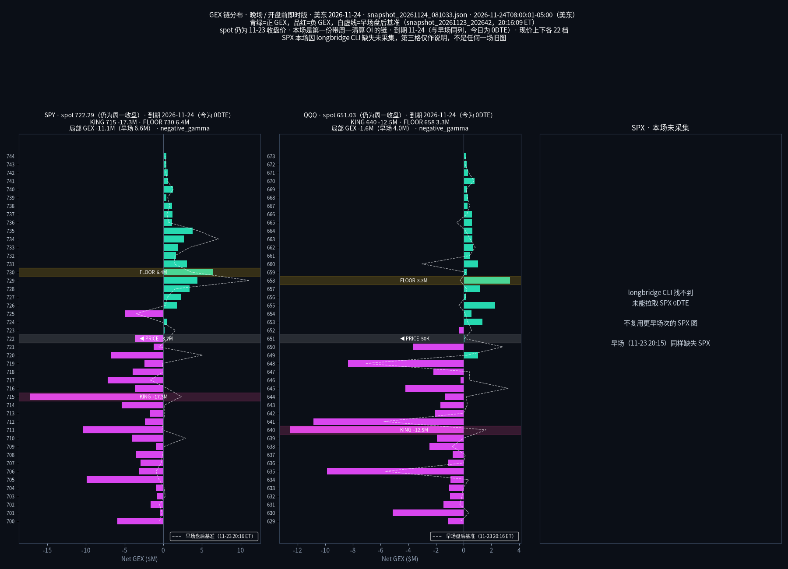
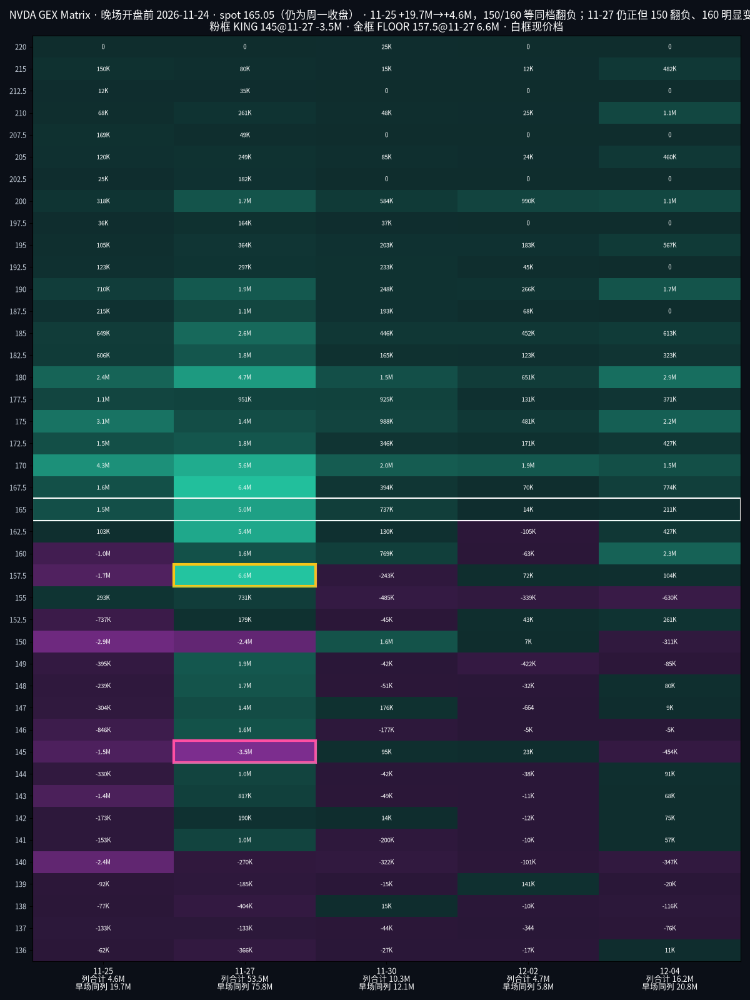
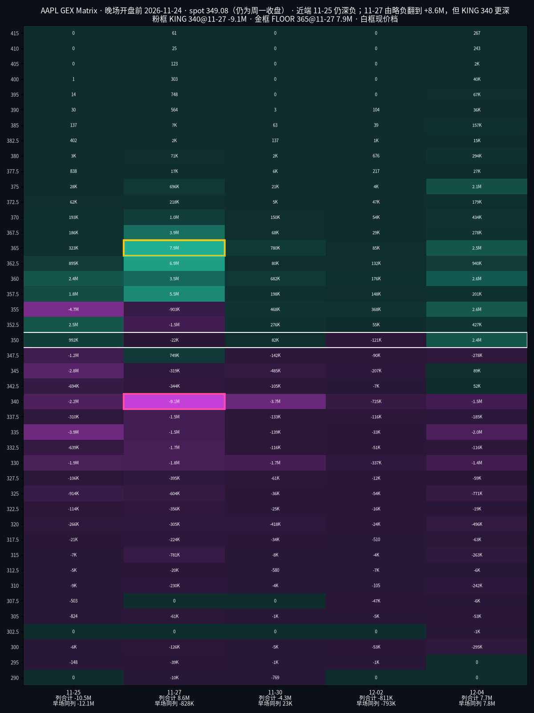
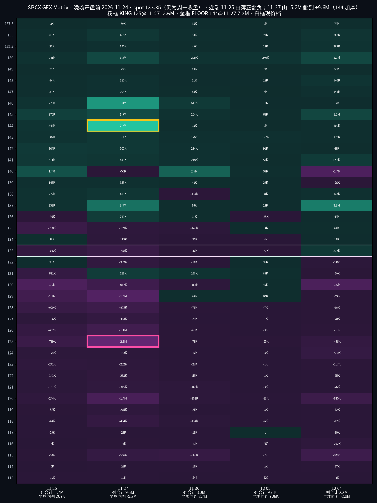
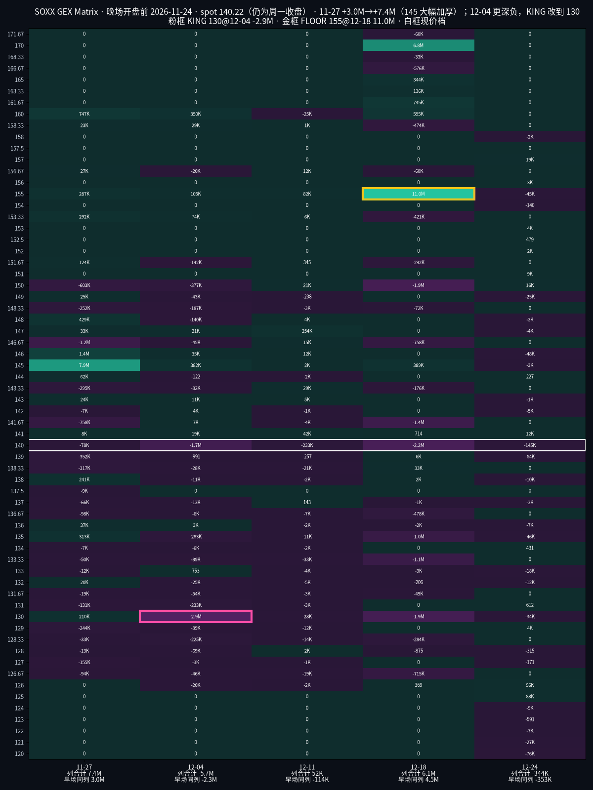

# GEX 晚场（开盘前即时版）日分析 · 美东交易日 2026-11-24（周二）08:00

**结论先行**
- 本场是**第一份带周一清算 OI** 的链。现货与周一收盘完全相同（SPY **722.29**、QQQ **651.03**），近端到期仍是 **11-24**，只是今天已真正变成 0DTE，**不是换月**。早场那份官方正 gamma，是周五清算 OI 在周一收盘价上的重定价（再叠窗口上移），不能当成周一盘中的仓位结论。
- 同列、同现货、窗口完全重叠（两只指数都是 51 档，一档都没滑走）。SPY 局部 **+6.6M→-11.1M**，体制 **正 gamma→负 gamma**，可见列净额 **+45.2M→-68.9M**；QQQ 局部 **+4.0M→-1.6M**，体制同样翻成负 gamma，可见列净额 **-7.8M→-57.9M**。同档变号是更强信号：SPY **715 / 720 / 710 / 722**，QQQ **640 / 645 / 650** 由正翻负。0DTE 的 gamma/时间可以放大已有负档，但不能解释正档变薄和大量翻负。
- 早场已提醒：QQQ 虽然官方标了正 gamma，可见列净额已经是 **-7.8M**，KING **648 -7.1M** 就在现价下方。本场局部也翻负了；同时上方 **655 / 658 / 660** 由负翻正，新 FLOOR 是现价之上的 **658 +3.3M**。不要只把整链更负写成「风险全面上升」，上沿结构也变了。
- **SPX 本场再次缺失**，错误仍是「找不到 longbridge CLI」。拉链跑在 `win-host`。矩阵 29/29、SPY/QQQ 各 102/102 完整，`collection.ok=false` 只因 SPX。早场同样没有 SPX，不复用任何一场旧图。
- 个股现货全部未变，同列对比几乎都是重叠格。变化大的：**NVDA 11-25 +19.7M→+4.6M**（150 / 160 翻负），11-27 仍正但明显变薄；**MSFT 11-25 -1.9M→-8.0M**；**AAPL 11-25 仍深负**，但 **11-27 -0.83M→+8.6M** 真实翻正（KING 340 反而更深）；**SPCX 11-25** 薄正翻负是真的，可是 **11-27 -5.2M→+9.6M** 同期大幅翻正，不能只看自动摘要的「转负」。自动摘要把 **CBRS** 标成「强力翻正」：方向对，但只有约 **+0.5M**，KING **93** 仍是 **-734k**，不宜当头条。

## 1) 数据与新鲜度
- 场次：晚场 / 开盘前即时版。目标时刻美东 2026-11-24 08:00（北京 2026-11-24 21:00）。相对北京 **22:30**（美东 09:30）开盘，本场快照够新。
- 读取文件：仓库 `wikiTang-code/whop-wechat-bridge` 分支 `feat/chg064-offline` 的 `data/gex/20261124/snapshot_20261124_081033.json`（目录内 `latest.json` 带有 `preopen` / `oi_inventory` 等元数据；不要用仓库根上可能过期的 latest 指针）。同日目录当时还没有早场 JSON——早场是周一盘后，落在 `data/gex/20261123/`。
- 生成时间 `generated_at`：**2026-11-24T08:00:01-05:00**（北京 21:00:01）。拉链 08:00:00 ET 开始，**08:10:33 ET** 完成（北京 21:10:33），截止 08:25、完成窗口 08:20–08:25，`deadline_status=on_time`，`spot_session=premarket`，`host=win-host`，`oi_inventory=prior_close_t1`，`oi_as_of=yesterday_close`。归档推送时间为北京 **21:10:33**（提交 `f0c96c0`）。
- 采集：富途 OpenD `us_option=LV1`。SPY/QQQ 各 102/102，矩阵 29/29。SPX 失败：`找不到 longbridge CLI`（安装提示仍是 Windows 的 `install.ps1`，与本场跑在 win-host 相符）。不把 `collection.ok=false` 当成总失败，只标明 SPX 缺席。
- 对照：同日早场已出的完整分析，基准快照是 `data/gex/20261123/snapshot_20261123_202642.json`（`generated_at` 2026-11-23T20:16:09-05:00，北京 11-24 09:16:09；报告 `analysis_morning_postclose.md`）。当时 11-24 已是近端列，但 OI 仍是周五清算、按周一收盘价重定价。本场现货与周一收盘完全相同，差异几乎就是周一清算后的仓位，叠上 11-24 变成 0DTE 后的 gamma 放大。盘前交易不改这批 OI。
- 快照里的 `change_pct` 仍是相对上一个交易日（周五）的涨幅，不是隔夜变动；下面一律按计算得到的 **0.00%** 来写现货。

## 2) 差异总览（核心）

### 指数 0DTE（到期 2026-11-24，与早场同列）

| 标的 | 现货 | KING | FLOOR | 局部 GEX | 可见列合计（正/负/净） | 体制 |
|---|---|---|---|---|---|---|
| SPY | 722.29（未变） | **715 -17.3M**（早场 725 -3.5M；715 由 +2.3M 翻负） | **730 +6.4M**（早场 729 +11.2M，本场 729 收到 +4.4M；730 由 +3.6M 加厚） | **-11.1M**（早场 +6.6M） | 正 **+39.8M** / 负 **-108.7M** / 净 **-68.9M**（早场 +55.3M / -10.0M / +45.2M；51 档，697–747，一档都没滑走） | **正 gamma→负 gamma** |
| QQQ | 651.03（未变） | **640 -12.5M**（早场 648 -7.1M；640 由 +1.6M 翻负） | **658 +3.3M**（早场官方 FLOOR 645 +3.2M 在现价以下、体量小于当时的 KING，不是支撑；645 本场已翻到 -4.2M） | **-1.6M**（早场 +4.0M） | 正 **+17.9M** / 负 **-75.8M** / 净 **-57.9M**（早场 +16.4M / -24.2M / -7.8M；51 档，626–676，一档都没滑走） | **正 gamma→负 gamma** |
| SPX | 本场缺失 | — | — | — | 早场同样缺失，没有可对照的阶梯 | — |

分解（重叠格，不是窗口滑动）：
- SPY 重叠 51 档 **+45.2M→-68.9M**（Δ **-114.2M**），掉出/新进都是 0。同档翻转最大的是 **715 +2.3M→-17.3M**、**720 +5.1M→-6.8M**、**710 +2.9M→-4.1M**、**714 +0.19M→-5.4M**、现价档 **722 +0.69M→-3.7M**。已有负档明显加深：**711 -0.16M→-10.4M**、**705 -0.54M→-9.9M**、**717 -1.7M→-7.2M**，早场那块口袋 **725 -3.5M→-4.9M** 还在现价上方。正侧不是被 0DTE 放大，而是在收：**729 +11.2M→+4.4M**、**734 +7.1M→+2.6M**、早场枕垫 723 **+1.6M→+0.16M**；新 FLOOR **730 +3.6M→+6.4M**，728 / 727 也有加厚。正档合计从 +55.3M 收到 +39.8M，负档从 -10.0M 扩到 -108.7M。
- QQQ 重叠 51 档 **-7.8M→-57.9M**（Δ **-50.1M**），同样没有窗口滑动。下沿和现价附近翻负或加深：**640 +1.6M→-12.5M**、**645 +3.2M→-4.2M**、**650 +2.8M→-3.7M**、**630 +0.37M→-5.1M**，早场 KING **648 -7.1M→-8.4M**，**641 -5.8M→-10.8M**、**635 -5.7M→-9.9M**。但上方同时翻正：**658 -0.25M→+3.3M**（新 FLOOR，现价上约 7 点）、**655 -0.34M→+2.3M**、**660 -3.0M→+1.0M**、**665 -0.50M→+0.61M**。正档合计几乎没掉（+16.4M→+17.9M），净额变差主要来自下沿负墙加厚和近端翻负。

未变的一句带过：两只指数的现货、到期日和可见列宽度都没改；GOOGL 近端 11-25、COIN 11-27 的列符号和量级也基本没动。

### 矩阵重点（现货全部仍是周一收盘；同列对比，已复核官方合计）

| 标的 | 现货 | 近端列（同到期） | KING | FLOOR | 备注 |
|---|---|---|---|---|---|
| NVDA | 165.05 | 11-25 **+19.7M→+4.6M**（重叠 41 档，Δ -15.1M，无窗口损失） | 仍是 **145@11-27**（-0.94M→**-3.5M**，加深） | 160@11-27 +8.2M → **157.5@11-27 +6.6M** | 近端 160 **+4.3M→-1.0M**、150 **+1.7M→-2.9M**、140 / 157.5 / 145 也翻负；上沿 170 / 175 / 180 反而加厚。**11-27 仍正 +75.8M→+53.5M**，但 150 由 +2.2M 翻到 -2.4M，160 从 +8.2M 收到 +1.6M。还是正列，近端结构已经差很多 |
| MSFT | 492.50 | 11-25 **-1.9M→-8.0M**（重叠 Δ -6.1M） | 仍是 **490@11-27**（-5.1M→-5.3M，现价下 2.5 点） | 502.5@11-27 → **510@11-27 +1.9M**（由 -0.24M 翻正） | 近端 490 从接近 0 走到 -2.2M，497.5 -0.16M→-2.4M。11-27 仍负，只是从 -5.4M 收到 -3.7M。继续按负列处理 |
| AAPL | 349.08 | 11-25 **-12.1M→-10.5M**（仍深负；347.5 +0.17M→-1.2M） | 仍是 **340@11-27**（-7.4M→**-9.1M**，加深） | 362.5@11-27 +6.3M → **365@11-27 +7.9M** | **11-27 -0.83M→+8.6M** 是真实翻正（355 从 -5.1M 收到 -0.90M，360 / 365 加厚），但 340 更深，不能把周列翻正当成近端已经转正。11-30 反而从接近 0 翻到 -4.3M |
| AMZN | 255.39 | 11-25 **+2.2M→+0.44M**（明显变薄；240 加深到 -1.4M） | 235@12-04 → **240@12-04 -2.1M** | 仍是 **260@11-27**（+4.9M→+4.6M） | **11-27 仍厚正 +25.9M→+21.7M**，只是略收。近端变薄，周列结构还在 |
| SPCX | 133.35 | 11-25 **+0.21M→-1.7M**（重叠真实翻负；135 +0.41M→-0.79M） | 仍是 **125@11-27**（-2.5M→-2.6M） | 140@11-30 +2.4M → **144@11-27 +7.2M** | 自动摘要只写了近端转负。同场 **11-27 -5.2M→+9.6M**（144 +0.58M→+7.2M，146 / 137 也大幅转正），**12-04 -2.9M→+2.2M** 也翻了。近端转负是真的，但后面那一列同时在翻正 |
| SOXX | 140.22 | 11-27 **+3.0M→+7.4M**（145 +0.37M→**+7.9M**） | 140@12-18 → **130@12-04 -2.9M**（130 由接近 0 加深） | 仍是 **155@12-18**（+9.8M→+11.0M） | 近端加厚集中在 145 / 146；135 从 +3.7M 收到 +0.31M。12-04 更深负 **-2.3M→-5.7M**。12-18 仍正并加厚到 +6.1M |
| SOXL | 43.21 | 11-27 **+3.5M→+2.0M** | 35@12-18 → **40@11-27 -2.3M**（40 由 +0.69M 翻负，就在现价下约 3 点） | 仍是 **50@11-27**（+1.5M→+2.1M） | 近端还是正列，但现价下方刚翻出一块新负墙。12-18 仍负并加深到 -3.4M |
| TSLA | 385.46 | 11-25 **+2.8M→+5.6M**（400 / 395 加厚；380 / 375 / 390 却翻负） | 392.5@11-30 → **350@11-27 -1.2M**（更远） | 395@11-27 → **390@11-27 +4.0M** | 11-27 仍厚正 +32.4M→+34.0M。近端加厚和局部翻负同时发生，不要只看列合计 |
| META | 597.60 | 11-25 仍薄正 **+0.54M→+0.89M** | 605@11-27 → **580@11-27 -0.95M** | 625@11-27 → **635@11-27 +1.4M**（由接近 0 翻出） | 11-27 **-0.19M→+1.1M** 翻了，但体量一般，不是 NVDA / AAPL 那种量级 |
| GOOGL | 282.10 | 11-25 **+1.6M→+1.6M**（几乎未动；275 / 280 翻负，290 加厚） | 270@12-04 → **270@11-27 -1.2M**（同档换到更近的到期） | 仍是 **290@11-27**（+5.0M→**+6.5M**） | **11-27 仍厚正 +16.7M→+16.4M**。七姐妹里近端最稳的一列 |
| MU | 707.70 | 11-25 **+0.91M→+0.37M**（变薄） | 665@11-27 → **670@11-25 -0.43M**（较远） | 仍是 **750@11-27**（+1.2M→+0.40M，变薄） | 11-27 从 +2.1M 收到 +0.23M。不是符号翻转，只是变薄 |
| INTC | 59.66 | 11-27 **+12.4M→+6.3M**（几乎减半；56 从 -2.4M 加深到 -4.5M） | 仍是 **56@11-27 -4.5M** | 仍是 **70@12-18**（+5.8M→+6.3M） | 近端仍正，但薄了不少。12-18 仍厚正 +12.5M→+13.9M |
| COIN | 108.78 | 11-27 **+10.0M→+10.7M**（略加厚） | 仍是 **110@12-18 -1.3M**（现价上约 1.2 点） | 仍是 **116@11-27 +2.6M** | 墙位和符号都没改，带过即可 |
| CBRS | 98.51 | 11-27 **-0.72M→+0.51M**（重叠真实翻正，主要是 100 由 -0.11M 走到 +0.45M） | 仍是 **93@11-27 -0.73M**（几乎未动） | 105@12-04 → **100@11-27 +0.45M** | 自动摘要的「强力翻正」方向对，但体量只有五十万级，负 KING 还在，不应和指数或 NVDA 并列 |
| RIOT | 17.15 | 11-27 **+28.1M→+39.0M**（19.5 从接近 0 加到 +8.2M） | 仍是 **14@12-18 -1.8M** | 17.5@11-27 → **21.5@12-04 +8.9M** | **12-04 +0.99M→+31.2M** 也在远档大幅加厚。是加厚，不是翻号 |

其余未展开的：CIFR 11-27 继续加厚（+1.9M→+4.6M），CRWV / NBIS 近端仍正、略收，IREN 近端仍负。GLW / ONDS / PL 近端有小额翻正，体量都在几十万级，不单列。

## 3) 附图
- 指数链：SPY / QQQ 并排，青绿正 GEX、品红负 GEX，标出现价、KING、FLOOR；白虚线为早场盘后同一 11-24 列的对照。第三格是 SPX 缺失说明，**不是**任何一场旧图。本场图按晚场快照新绘。
- 个股到期矩阵（结构变化大的才附）：NVDA（近端大幅变薄并多档翻负）、AAPL（近端仍负、11-27 翻正）、SPCX（近端翻负与 11-27 翻正交织）、SOXX（145 加厚、KING 下移）。列头附早场同列合计。

## 4) 差异的可能含义，以及开盘观察短清单（非荐股）

本场现货没有盘前漂移，差异不是价格走出来的，而是周一盘中清算后的 OI 第一次出现在书上，再叠上 11-24 变成 0DTE 后的 gamma 放大。早场把新 11-24 列标成正 gamma，在当时的数据口径里并不算算错——那是周五 OI 的重定价；但把它当成「周一反弹后近端已经转正」，会被本场打脸。正档在缩小、许多同档在翻负，这不是单纯的时间衰减放大。

QQQ 更不宜写成单一方向：下沿和现价附近确实更负，但 655 / 658 / 660 同时翻正，官方 FLOOR 第一次来到现价上方。SPCX 也是「近端转负、周列转正」的组合，自动摘要只抓住了前半句。

开盘观察（只是对照清单，不是交易建议）：
- **SPY 722.29**：现价档 722 和下方 720 都已从正翻负（-3.7M / -6.8M）；再往下是新 KING **715 -17.3M**，以及 711 / 705 两堵新的大负墙。上方 725 仍是 -4.9M 的口袋；正堆在 **730 +6.4M** 和已收薄的 729 +4.4M。看开盘是停在 722–725，还是先回测 720 / 715。
- **QQQ 651.03**：先看现价下沿 **650 -3.7M** 和仍在的 **648 -8.4M**，再看上方新正墙 **655 +2.3M / 658 +3.3M**。早场那个 645 正 FLOOR 已经翻负，不要再当支撑用。
- **NVDA**：近端还是官方正列，但 150 / 160 已经翻负，11-27 的 150 也翻了。不要再用早场 +19.7M 的近端合计做盘前假设。
- **AAPL**：11-25 仍深负；11-27 虽已翻正，KING 340 更深。若看的是周列，先分清到期，不要把 +8.6M 直接安到现价附近。
- **MSFT**：近端加深到 -8.0M，490 仍是紧贴现价的负 KING。
- **SOXL**：40 刚翻成 -2.3M，并成为新 KING，就在 43.21 下方约 3 点。
- **SPCX**：近端转负和 11-27 大幅翻正同时存在，不要只跟自动摘要的「转负破位」。
- **SPX** 本场仍无阶梯，指数只以 SPY / QQQ 为准。

盘前交易不会改这批 OI；开盘后的 gamma 放大仍可能继续改变体量，符号要以随后的成交和下一份清算链为准。
