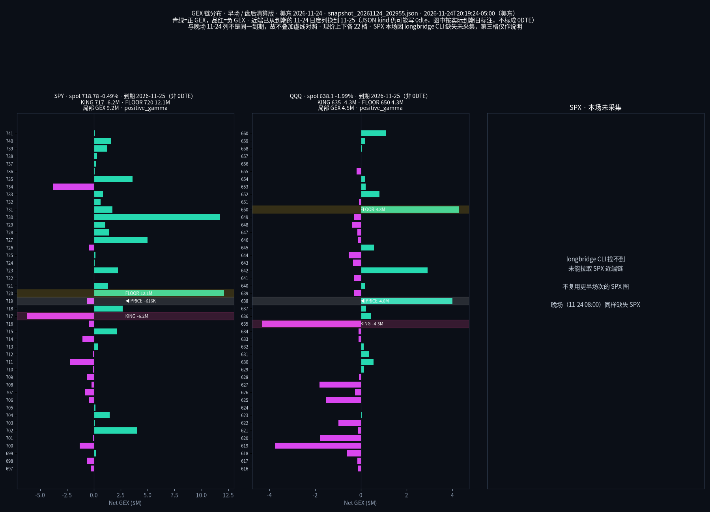
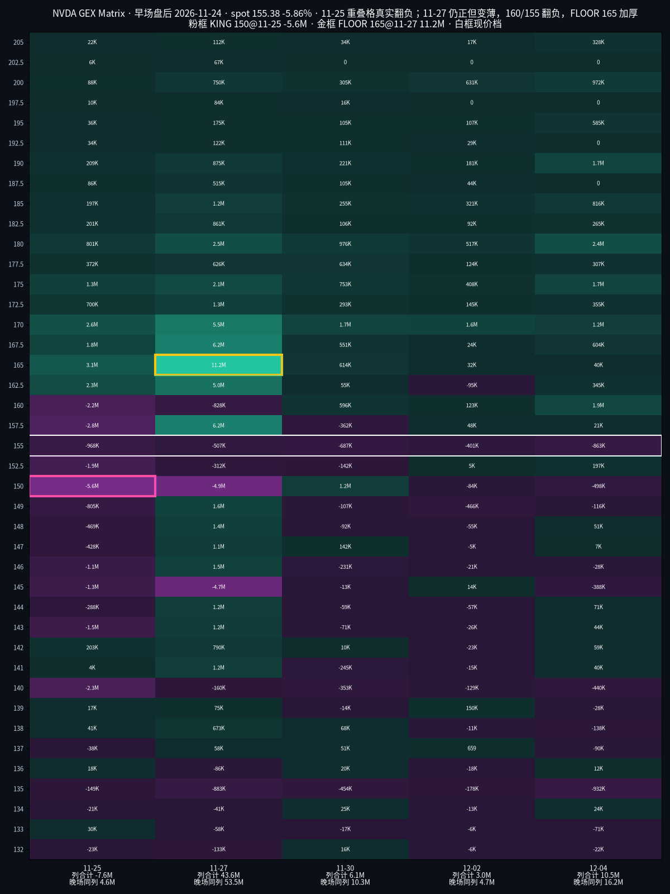
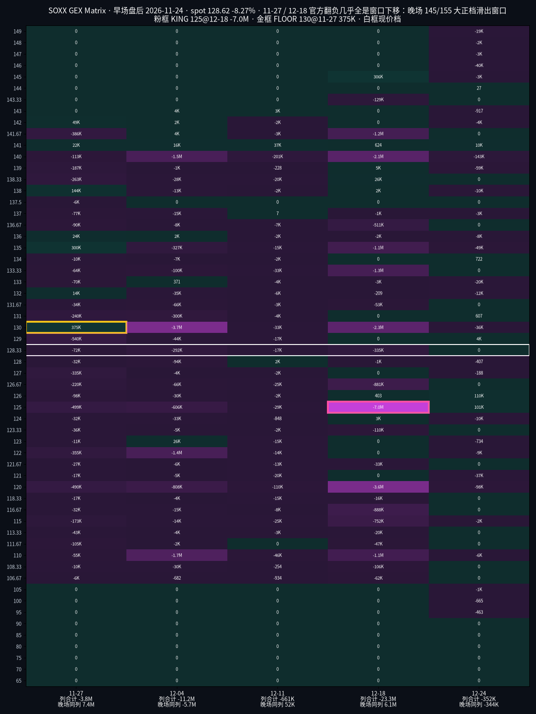
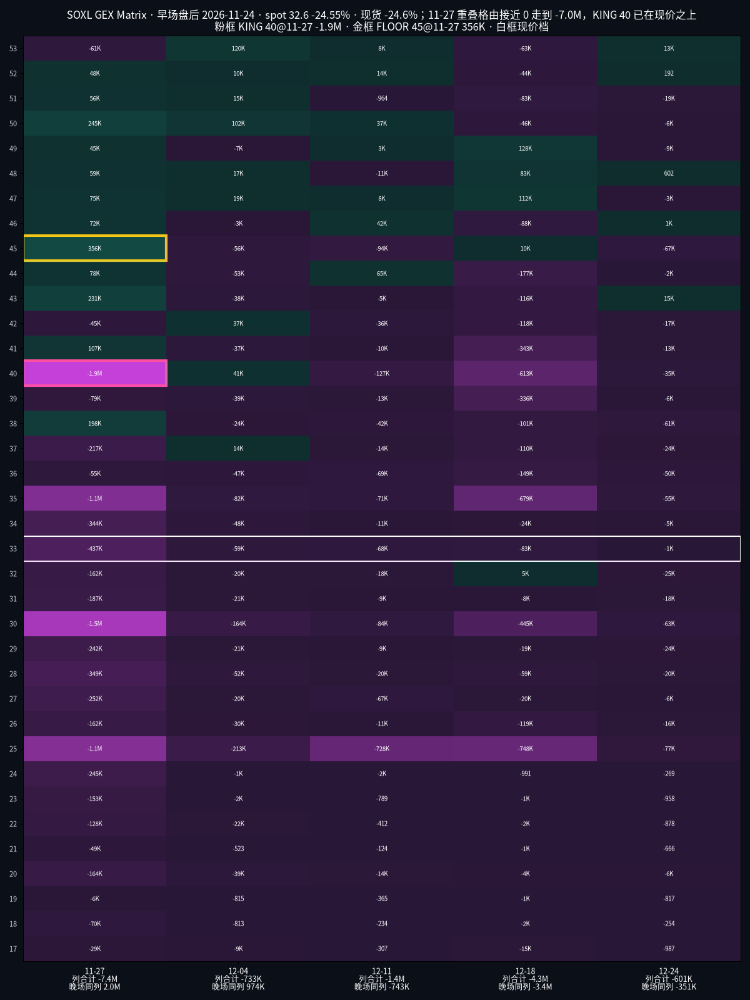
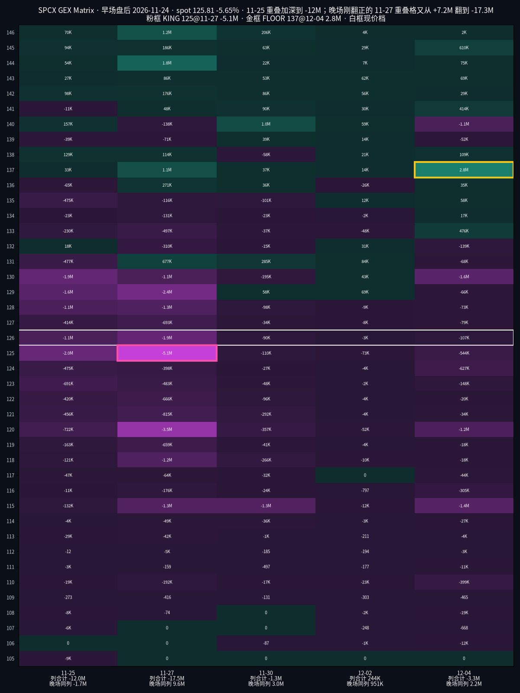
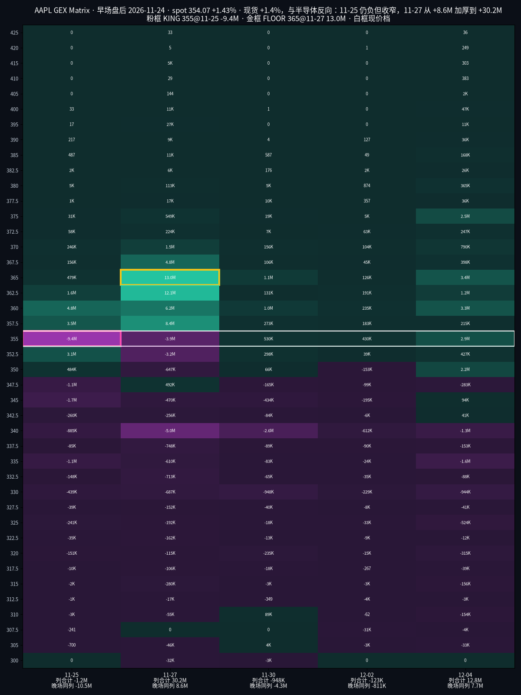

# GEX 早场（盘后清算版）日分析 · 美东交易日 2026-11-24（周二）20:15

**结论先行**
- 周二指数只小跌（SPY **722.29→718.78，-0.49%**），纳指弱一些（QQQ **651.03→638.10，-1.99%**），但半导体和相关成长股是另外一场：SOXL **-24.6%**（43.21→32.60），MU **-11.0%**，NVDA **-5.9%**，SOXX **-8.3%**，SPCX **-5.7%**。AAPL 反而 **+1.4%**，不要和半导体混读。
- 指数近端已从到期的 **11-24** 换到 **11-25**（JSON `kind` 仍写 0dte，本文按实际到期日写，**不标成 0DTE**）。这是换月，不是同一列的仓位结论。`oi_inventory=prior_close_t1`，本场仍是周一清算 OI 按周二收盘价重定价，再叠 ±20 档窗口滑动；周二清算 OI 要等周三 08:00。官方正 gamma / 局部翻正，不能当成「周二负体制已经走完」。
- 新列上：SPY 局部 **-11.1M→+9.2M**，可见列净额从到期列的 **-68.9M** 变成新列 **+36.8M**，体制 **负 gamma→正 gamma**。但现价下方紧贴着 KING **717 -6.2M**，FLOOR 是紧上方的 **720 +12.1M**，再往上还有 **730 +11.7M**。QQQ 官方同样标了正 gamma、局部 **-1.6M→+4.5M**，可是可见列净额是 **-2.2M**，KING **635 -4.3M** 就在收盘下约 3 点，现价档 **638 +4.0M** 才是近端最大正档。不要只把官方体制翻正当头条，阶梯和列净额要一起看。
- **SPX 连续第三场缺失**（晚场和本场，再往前周一盘后也缺），错误仍是「找不到 longbridge CLI」。拉链跑在 `win-host`。矩阵 29/29、SPY/QQQ 各 102/102 完整，`collection.ok=false` 只因 SPX。不复用任何一场旧 SPX 图。
- 个股里，自动摘要列出的大量「转负」不能一视同仁。**NVDA 11-25 +4.6M→-7.6M** 是重叠格主导（窗口只有 0.56M）；**SOXL 11-27** 重叠格从接近 0 走到 **-7.0M**；**SPCX 11-25** 已有负列加深到 **-12.0M**，而且晚场刚翻正的 **11-27 +9.6M**，重叠格又从 **+7.2M 翻到 -17.3M**。相反，**SOXX 11-27 / 12-18** 和 **MU 近端** 的官方翻负，主要是窗口随暴跌下移，重叠格并没有同步完成「由正翻负」。AAPL 是反向样本：近端仍负但收窄，**11-27 +8.6M→+30.2M** 大幅加厚。

## 1) 数据与新鲜度
- 场次：早场 / 盘后清算版。目标时刻美东 2026-11-24 20:15（北京 2026-11-25 09:15）。
- 读取文件：仓库 `wikiTang-code/whop-wechat-bridge` 分支 `feat/chg064-offline` 的 `data/gex/20261124/snapshot_20261124_202955.json`（目录内 `latest.json` 带有 `preopen` / `oi_inventory` 等元数据；不要用仓库根上可能过期的 latest 指针）。同日晚场对照是 `data/gex/20261124/snapshot_20261124_081033.json`。
- 生成时间 `generated_at`：**2026-11-24T20:19:24-05:00**（北京 2026-11-25 09:19:24）。拉链 20:10 ET 唤醒，目标 20:15，实际 20:19:22 开始拉链，**20:29:55 ET** 完成（北京 09:29:55），完成窗口 20:35–20:40、截止 20:40，`deadline_status=on_time`，`late=false`，`pulled_before_chain_target=false`（比 20:15 晚约 4 分钟，仍在截止前）。`spot_session=closed_or_extended`，`host=win-host`，`oi_inventory=prior_close_t1`，`oi_as_of=yesterday_close`。归档推送时间为北京 **09:29:55**（提交 `c37ddd5`）。相对本场目标时刻，数据新鲜、准时。
- 采集：富途 OpenD `us_option=LV1`。SPY/QQQ 各 102/102，矩阵 29/29。SPX 失败：`找不到 longbridge CLI`（安装提示仍是 Windows 的 `install.ps1`，与本场跑在 win-host 相符）。不把 `collection.ok=false` 当成总失败，只标明 SPX 缺席。
- 对照：同日晚场已出的完整分析，基准快照是 `data/gex/20261124/snapshot_20261124_081033.json`（`generated_at` 2026-11-24T08:00:01-05:00，北京 21:00:01；报告 `analysis_evening_diff.md`）。当时 11-24 已是 0DTE，且是第一份周一清算 OI；本场 11-24 已经到期离开，新列是 11-25。快照里的 `change_pct` 是相对周一收盘，与用两场现货算出的涨跌一致。

## 2) 差异总览（核心）

### 指数近端（到期 2026-11-25，已换月；晚场是到期的 11-24 列）

| 标的 | 现货 | KING | FLOOR | 局部 GEX | 可见列合计（正/负/净） | 体制 |
|---|---|---|---|---|---|---|
| SPY | **718.78（-0.49%）** | **717 -6.2M**（晚场到期列 715 -17.3M） | **720 +12.1M**（晚场到期列 730 +6.4M） | **+9.2M**（晚场到期列 -11.1M） | 正 **+57.5M** / 负 **-20.7M** / 净 **+36.8M**（晚场到期列 +39.8M / -108.7M / -68.9M；新列 51 档，694–744） | **负 gamma→正 gamma**（新列，不是同列翻转） |
| QQQ | **638.10（-1.99%）** | **635 -4.3M**（晚场到期列 640 -12.5M） | **650 +4.3M**（晚场到期列 658 +3.3M） | **+4.5M**（晚场到期列 -1.6M） | 正 **+17.0M** / 负 **-19.2M** / 净 **-2.2M**（晚场到期列 +17.9M / -75.8M / -57.9M；新列 51 档，613–663，窗口下移 13 档） | **负 gamma→正 gamma**（新列；可见列净额仍为负） |
| SPX | 本场缺失 | — | — | — | 晚场同样缺失，没有可对照的阶梯 | — |

分解（换月，地理重叠只作位置参考，不当成同一列仓位变化）：
- SPY 新列 51 档净额 **+36.8M**，正档明显多于负档。最大正墙是紧贴收盘上方的 **720 +12.1M**（FLOOR，现价上 1.2 点）和 **730 +11.7M**；**727 +5.0M**、**702 +4.0M**、**735 +3.6M**、收盘下方 **718 +2.7M** / **715 +2.2M** 也还在。真正要盯的洞是现价下 1.8 点的 KING **717 -6.2M**，以及 **711 -2.2M**、**734 -3.8M**（现价上约 15 点的负口袋）。现价档 719 本身是薄负（-0.62M）。官方正 gamma 和局部 +9.2M 与这条阶梯并不矛盾，但不能忽略贴身的负 KING。
- QQQ 现货掉了近 13 点，窗口下移 13 档（664–676 离开，合计约 +5.0M；613–625 一带进入，合计约 -9.8M）。新列净额 **-2.2M**，所以官方正 gamma 只描述局部，不描述整段可见链。近端结构是：现价档 **638 +4.0M**，下方 KING **635 -4.3M**，上方 FLOOR **650 +4.3M**（约 12 点），近处还有 **642 +2.9M**。下沿 619 / 620 / 627 / 625 是成片的负墙。不要把「体制翻正」写成上沿已经打开。
- 两场都没有 SPX，波动哥点位这一节对不到墙。

### 矩阵重点（同列对比，已复核官方合计，并拆成重叠格 vs 窗口滑动）

本场现货变动很大，尤其是半导体；自动摘要的「转负破位」先当线索，以下按重叠格判断是不是真翻。

| 标的 | 现货 | 近端列（同到期） | KING | FLOOR | 备注 |
|---|---|---|---|---|---|
| NVDA | 165.05→**155.38（-5.86%）** | 11-25 **+4.6M→-7.6M**（重叠 37 档 +4.2M→-7.5M，窗口只有 0.56M，真实翻负） | **150@11-25 -5.6M**（晚场 145@11-27 -3.5M；150 由 -2.9M 加深） | **165@11-27 +11.2M**（晚场 157.5@11-27 +6.6M；165 由 +5.0M 加厚） | 近端 155 / 157.5 也转负或加深。**11-27 仍正 +53.5M→+43.6M**（重叠 -8.4M），但 160 由 +1.6M 翻到 -0.83M，155 由 +0.73M 翻到 -0.51M。还是正周列，近端已经是负列，且 KING 下移到现价附近 |
| SOXL | 43.21→**32.60（-24.55%）** | 11-27 **+2.0M→-7.4M**。重叠 31 档其实晚场已接近 0（+60k）→**-7.0M**；官方晚场 +2.0M 里有约 +1.9M 上沿正档随后滑出窗口 | 仍是 **40@11-27 -1.9M**，但已在现价**上方** 7.4 点，不是下方支撑 | **45@11-27 +0.36M**（晚场 50@11-27 +2.1M；50 从 +2.1M 收到 +0.25M） | 重叠格恶化是真的（30 / 25 / 35 加深）。官方 FLOOR 又薄又在现价上方很远，不单独当阻力。12-18 仍负并略深到 -4.3M |
| SOXX | 140.22→**128.62（-8.27%）** | 11-27 官方 **+7.4M→-3.8M**，但重叠 24 档本来就是 **-1.6M→-1.8M**；官方翻负几乎全是窗口下移（滑出 145 +7.9M 等，窗口绝对值 11.0M） | **125@12-18 -7.0M**（晚场 130@12-04 -2.9M） | 官方变成 **130@11-27 +0.37M**，体量很小，不宜当墙 | **12-18 官方 +6.1M→-23.3M** 同样主要是窗口：重叠仍是 -8.9M→-9.5M，滑出 155 +11.0M / 170 +6.8M，滑入 125 -7.0M。不要把这两列的官方符号当仓位翻新 |
| SPCX | 133.35→**125.81（-5.65%）** | 11-25 **-1.7M→-12.0M**（重叠 34 档 -2.3M→-12.0M，窗口只有 0.64M，真实加深） | 仍是 **125@11-27**，**-2.6M→-5.1M**，现已贴着收盘 | **137@12-04 +2.8M**（晚场 144@11-27 +7.2M；144 从 +7.2M 收到 +1.8M） | 晚场刚强调过的 **11-27 +9.6M→-17.5M** 是真翻：重叠 +7.2M→-17.3M（窗口 2.7M 不是主因）。11-30、12-04 也转负或更深。不能再把周列当成「近端虽负、后面已翻正」 |
| MU | 707.70→**629.79（-11.01%）** | 11-25 官方 **+0.37M→-5.2M**，重叠只剩 10 档，且重叠净额 **-0.85M→-0.41M**（还略收窄）；官方变差主要是滑出正档、滑入 -4.7M | **600@11-27 -1.6M**（晚场 670@11-25） | **630@11-27 +1.9M**（贴着现价） | 11-27 官方 +0.23M→-3.4M 同样是窗口主导。这是价格下移带出来的列符号，不是重叠格翻新 |
| AAPL | 349.08→**354.07（+1.43%）** | 11-25 **-10.5M→-1.2M**（仍负，但重叠大幅收窄 +9.3M，几乎无窗口） | **355@11-25 -9.4M**（晚场 340@11-27 -9.1M；355 由 -4.7M 加深，就在现价上 0.9 点） | 仍是 **365@11-27 +13.0M**（由 +7.9M 加厚） | **11-27 +8.6M→+30.2M** 是真实加厚（362.5 / 365 大幅增加；340 从 -9.1M 收到 -5.0M）。近端仍负，周列明显变厚，和半导体反向 |
| MSFT | 492.50→**496.13（+0.74%）** | 11-25 **-8.0M→-9.0M**（重叠再深 1.0M） | 仍是 **490@11-27**（-5.3M→**-6.2M**，现价下约 6 点） | 仍是 **510@11-27 +2.6M**（由 +1.9M 略增） | 11-27 仍负，只是从 -3.7M 收到 -1.8M。继续按负近端处理 |
| TSLA | 385.46→**384.68（-0.20%）** | 11-25 **+5.6M→+4.3M**（略收；385 / 380 仍是近端负档） | **385@11-25 -0.99M**（晚场 350@11-27；贴着现价） | 仍是 **390@11-27 +4.8M**（由 +4.0M 加厚） | **11-27 仍厚正 +34.0M→+35.4M**。现货几乎没动，结构变化也小 |
| GOOGL | 282.10→**279.05（-1.08%）** | 11-25 **+1.6M→-0.17M**（重叠真实小幅翻负，窗口可忽略） | 仍是 **270@11-27 -1.3M** | 仍是 **290@11-27 +6.6M** | **11-27 仍厚正 +16.4M→+13.3M**。自动摘要的近端「转负」体量只有十几万，不宜当头条 |
| AMZN | 255.39→**252.29（-1.21%）** | 11-25 **+0.44M→-1.4M**（重叠真实翻负，窗口可忽略） | 仍是 **240@12-04 -2.0M** | 仍是 **260@11-27 +4.8M** | **11-27 仍厚正 +21.7M→+19.5M**。近端转负是真的，周列还在 |
| META | 597.60→**589.82（-1.30%）** | 11-25 仍薄正 **+0.89M→+0.33M** | 仍是 **580@11-27**（-0.95M→-1.1M） | 仍是 **635@11-27 +0.94M**（由 +1.4M 变薄） | 11-27 官方 +1.1M→-1.9M，窗口 1.8M 不小：重叠晚场已经是 -0.56M，再走到 -1.7M，滑出了 +1.6M。不要只写「周列转负」 |
| COIN | 108.78→**102.34（-5.92%）** | 11-27 **+10.7M→-0.93M**（重叠 +10.3M→-0.82M，窗口只有 0.48M，真实大翻负） | **101@11-27 -1.4M**（晚场 110@12-18；现价附近） | **109@11-27 +1.8M**（晚场 116 +2.6M） | 12-18 官方更深，主要是窗口滑出了 +2.2M 上沿，重叠几乎没动。近端翻负才是主变化 |
| INTC | 59.66→**54.80（-8.15%）** | 11-27 **+6.3M→-0.84M**（重叠几乎满窗，窗口可忽略，真实翻负） | 仍是 **56@11-27 -5.0M**（由 -4.5M 加深，现价上约 1.2 点） | 仍是 **70@12-18 +5.3M**（由 +6.3M 略收） | 近端转负是真的。12-18 仍厚正 +13.9M→+10.8M（这部分窗口更大） |
| CRWV | 48.33→**42.60（-11.85%）** | 11-27 官方 **+4.6M→-3.5M**；重叠 29 档 +2.0M→-2.1M 是真的变差，但窗口绝对值也有 4.0M（滑出 +2.5M、滑入 -1.4M） | **37.5@12-18 -4.4M**（晚场 40@12-18 -2.4M） | 仍是 **45@11-27 +1.8M**（由 +1.4M 略增，现价上方） | 重叠和窗口都在起作用。12-18 官方 -0.54M→-12.2M 则几乎全是窗口（绝对值 11.2M） |
| NBIS | 97.80→**87.31（-10.73%）** | 11-27 官方 **+2.5M→-2.8M**；重叠晚场只剩 +75k→-2.4M，同时滑出 110 +1.6M 等（窗口 2.8M） | **80@11-27 -1.0M**（由 12-18 换到更近到期） | **100@11-27 +0.57M**（晚场 110 +1.6M 已滑出） | 重叠确实走弱，但官方从 +2.5M 起步有一部分是窗口。不宜写成干净的「仓位翻负」 |

其余未展开的：CIFR 11-27 仍正但减薄（+4.6M→+2.5M）；IREN 近端更深负（-0.81M→-5.5M，重叠主导）；CBRS 11-27 官方翻负，窗口 1.4M，需和重叠一起看；LITE 官方小额翻负主要是窗口；RIOT 11-27 仍大幅为正但减薄（+39.0M→+25.6M）。

## 3) 附图
- 指数链：SPY / QQQ 并排，青绿正 GEX、品红负 GEX，标出现价、KING、FLOOR。第三格是 SPX 缺失说明，**不是**任何一场旧图。本场图按早场盘后快照新绘。因为近端已经换到 11-25，与晚场 11-24 列不是同一到期，**不叠加虚线对照**。到期日按 11-25 标注，不写成 0DTE。
- 个股到期矩阵（结构变化大的才附）：NVDA（近端真实翻负，周列仍正但 160/155 翻负）、SOXX（官方翻负几乎全是窗口下移）、SOXL（现货暴跌，重叠格明显走弱，KING 已在现价之上）、SPCX（近端加深，且晚场刚翻正的 11-27 又翻负）、AAPL（与半导体反向，11-27 大幅加厚）。列头附晚场同列合计。

## 4) 对照说明（再压缩一句）
同日晚场是 11-24 的第一份周一清算 OI，指数局部已经翻负、可见列净额很负。本场是换月后的 11-25 新列，再加上周一 OI 按周二收盘价重定价。指数官方体制翻正，描述的是这条新列在新现货上的样子，不是把晚场那条 0DTE 负链「盘中修回去了」。个股里，NVDA / SOXL / SPCX / COIN / INTC 的近端或周列重叠格变化值得单独看；SOXX / MU 的官方符号则先当成窗口滑动。

## 6) 波动哥点位 vs GEX
点位来源：Discord stockrocks「🌟波动哥」。撰写时今日 Discord 例行（窗口 11-24 09:00 至 11-25 09:00 北京）尚未见到新导出；本地最新完整窗口仍是 `/workspace/discord-daily-20261124/`，覆盖 11-21 09:00 至 11-24 09:00 北京。该窗口内最新一份五点位是 **2026-11-24 08:59:47（北京）**、针对 11 月 24 日盘中的标注。若今日 Discord 例行随后给出新点位，以新导出为准。

五点（2026-11-24 开盘前，未在此后已见导出中更新）：**7415.0 / 7330.0 / 7269.7 / 7156.9 / 7075.5**。同一早间（05:03）还提到 SPX 第一目标 7350、第二目标 7460；五点说明里另有 Call 压力 7450、Put 支撑 7000。这些不是五点本身，只作背景。

本场 **SPX 链缺失**，无法列出这些行权价（或最近档）上的 GEX 金额与正负，也不能量相对本场 SPX 现价的距离。不复用更早的 SPX 阶梯来填这张表。按既有约定，用 SPX 7376.86 = SPXL 246.75 的 3 倍线性关系，只换算对应 SPXL 价格（用户持有 SPXL），不做吻合判断：

| 波动哥 SPX 点位（11-24 开盘前） | 对应 SPXL（线性） | 本场 SPX 链 |
|---|---|---|
| 7415.0 | 248.03 | 缺失，对不到 |
| 7330.0 | 245.18 | 缺失，对不到 |
| 7269.7 | 243.17 | 缺失，对不到 |
| 7156.9 | 239.39 | 缺失，对不到 |
| 7075.5 | 236.67 | 缺失，对不到 |

补充换算，仍不是定点：7350→245.85，7460→249.53，7450→249.20，7000→234.14。本场没有 SPX 现货，只能提醒：周二 QQQ 已收在 638.10，SPY 收在 718.78；这些偏高的五点相对当前指数邻域仍然偏上，但在没有 SPX 阶梯之前，停在「对不到墙」。

## 7) 可执行观察（非荐股）
1. 先记住近端已经换到 **11-25**，晚场 11-24 的 715 / 640 那些墙已经到期离开。开盘后若还拿到期列当锚，位置是错的。这是周一 OI 在周二收盘价上的结构，周三 08:00 才会第一次打上周二清算 OI。
2. SPY：新列整体偏正，优先看收盘夹在 **717 -6.2M** 和 **720 +12.1M** 之间这一小段，以及上方 **730 +11.7M**。官方正 gamma 成立，但不等于脚下没有负洞。
3. QQQ：不要被官方正 gamma 带走。可见列净额仍是 **-2.2M**。先看现价档 **638 +4.0M**、下方 **635 -4.3M**，以及 650 的正档和 619/620/627 的下沿负墙，放在一起看。
4. 半导体不要只看自动摘要的「转负」。NVDA 近端、SOXL 11-27 重叠格、SPCX 近端和刚刚翻正的 11-27，是重叠格主导的变化；SOXX、MU 的官方符号先当成窗口下移。SOXL 的 KING 40 已经在现价上方，不能再当下方支撑。AAPL 是反向样本，近端仍负、周列在加厚。
5. SPX 已连续多场在 `win-host` 上因 longbridge CLI 缺失而缺席。波动哥点位这一节继续只能记录「对不到」。要恢复对照，需要在实际拉链主机上修好 CLI，而不是回看旧图。

---
报告基于 `snapshot_20261124_202955.json` 与晚场 `snapshot_20261124_081033.json` 自行重算列合计与重叠格，不直接采用自动摘要的「转负破位」表述。结构快照不是预测，不构成投资建议。
