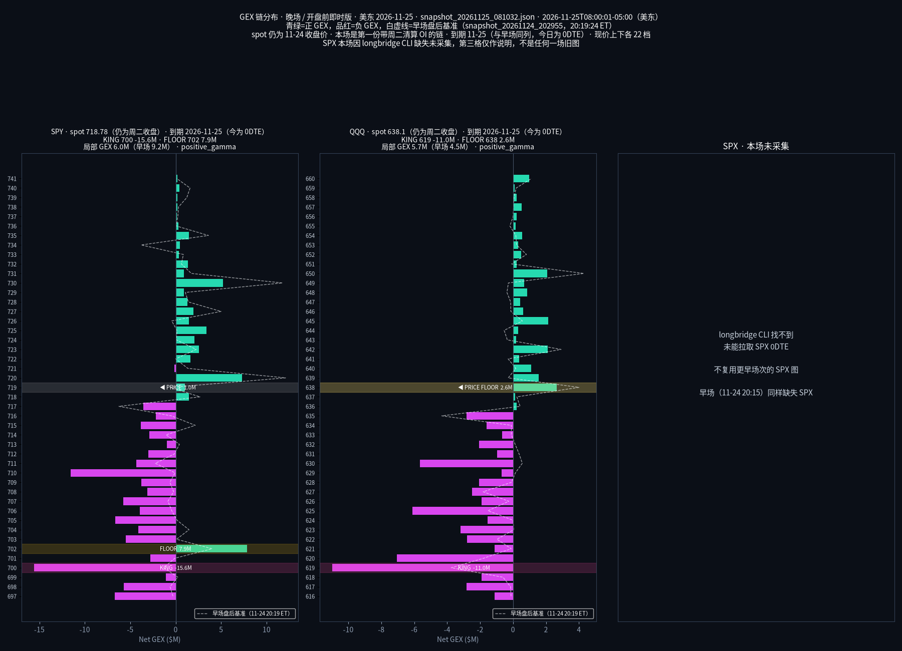
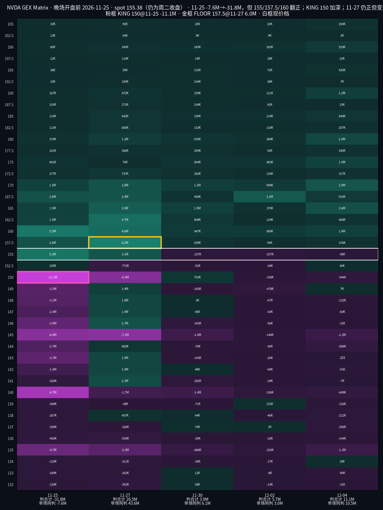
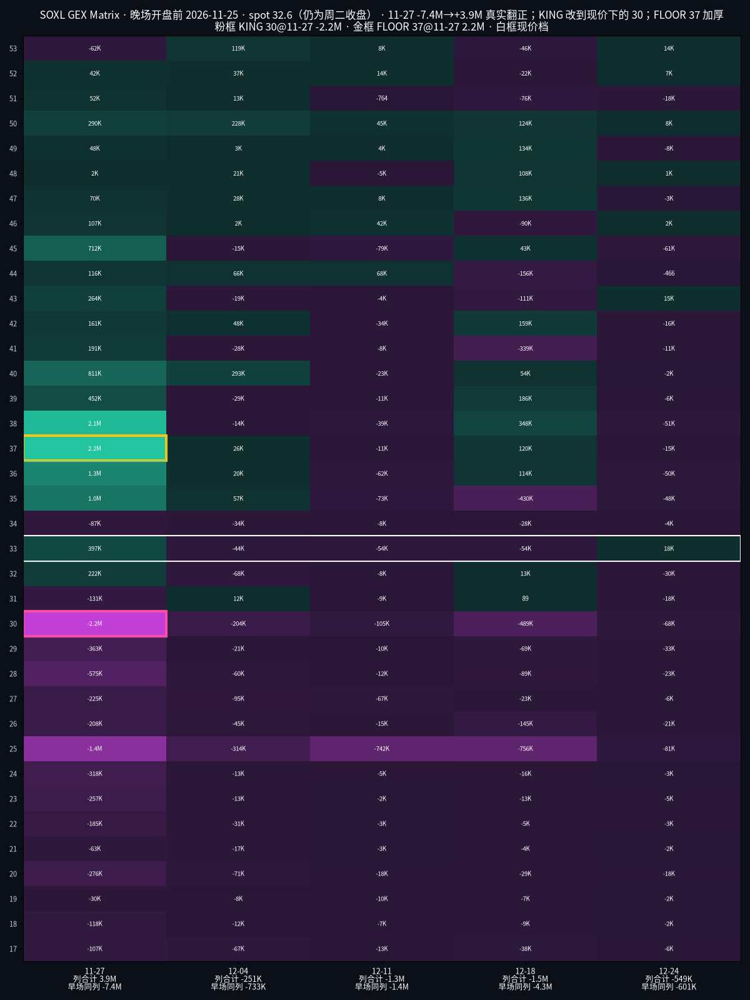
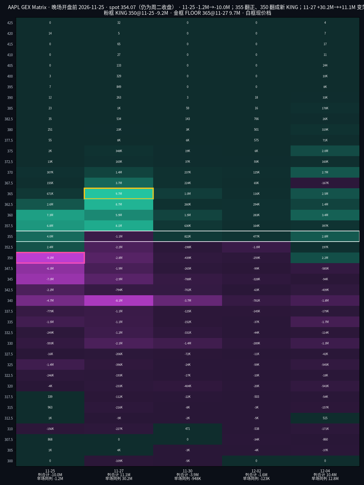
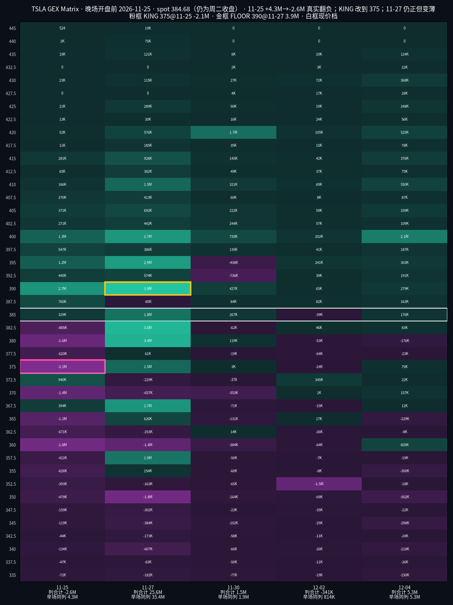
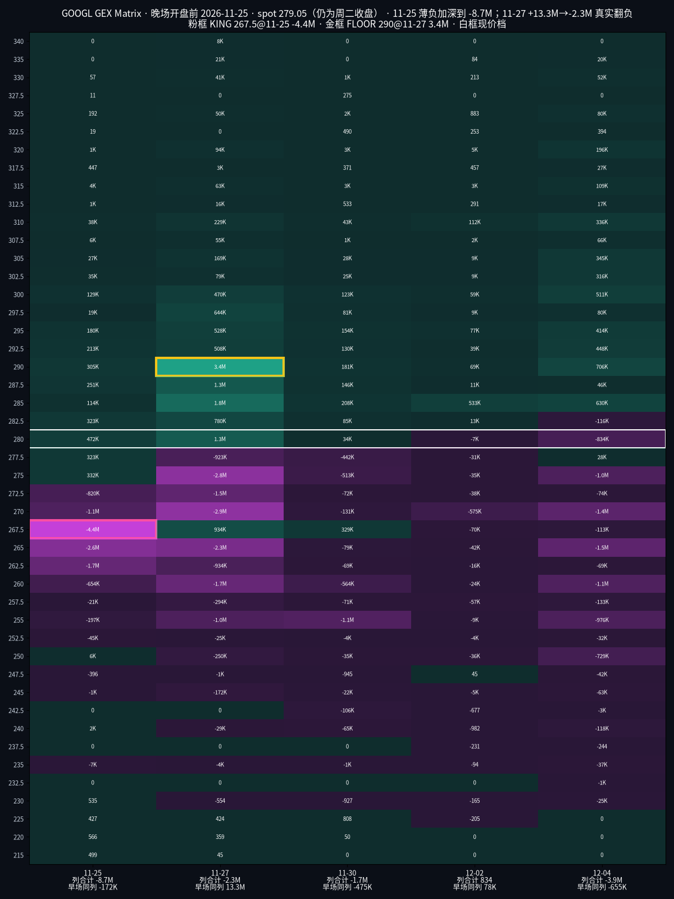

# GEX 晚场（开盘前即时版）日分析 · 美东交易日 2026-11-25（周三）08:00

**结论先行**
- 本场是**第一份带周二清算 OI** 的链。现货与周二收盘完全相同（SPY **718.78**、QQQ **638.10**），近端到期仍是 **11-25**，只是今天已真正变成 0DTE，**不是换月**。早场那份官方正 gamma、以及 SPY 新列可见净额 **+36.8M**，是周一清算 OI 在周二收盘价上的重定价（再叠窗口下移），不能当成「周二盘中已经把近端做成完整正体制」的结论。
- 同列、同现货、窗口完全重叠（两只指数都是 51 档，一档都没滑走）。SPY 局部仍正 **+9.2M→+6.0M**，官方体制仍是正 gamma，但可见列净额 **+36.8M→-67.8M**；QQQ 局部甚至略增 **+4.5M→+5.7M**，官方同样仍是正 gamma，可见列净额却从 **-2.2M 走到 -44.4M**。不要只把官方体制或局部 GEX 当头条，阶梯和列净额要一起看。
- 官方 FLOOR 也要改读法：SPY 新 FLOOR 是现价下方 16.8 点的 **702 +7.9M**，不是头顶阻力；紧上方仍是 **720 +7.3M**（早场 +12.1M，已收薄）。QQQ 新 FLOOR 就在现价档 **638 +2.6M**；上方同时有新的正档（639 / 644–649 等由负翻正），下沿 630 / 625 / 620 / 619 则明显加深。不要只把整链更负写成「风险全面上升」。
- **SPX 连续第四场缺失**（周一盘后、周二晚场、周二盘后、本场），错误仍是「找不到 longbridge CLI」。拉链跑在 `win-host`。矩阵 29/29、SPY/QQQ 各 102/102 完整，`collection.ok=false` 只因 SPX。不复用任何一场旧 SPX 图。
- 个股现货全部未变，同列对比几乎都是重叠格。变化大的：**NVDA 11-25 -7.6M→-31.8M**（KING 150 加深），但现价附近 155 / 157.5 / 160 由负翻正；**SOXL 11-27 -7.4M→+3.9M** 是真实大翻正（自动摘要「强力翻正」这次说对了）；**TSLA 11-25 +4.3M→-2.6M**、**GOOGL 11-27 +13.3M→-2.3M**、**AMZN 11-27 +19.5M→+2.5M**、**MSFT 11-27 -1.8M→-11.8M** 都是重叠格上的真实重构。自动摘要把 **NBIS** 也标成「强力翻正」：方向对，但只有 **+24.3k**，不宜当头条。

## 1) 数据与新鲜度
- 场次：晚场 / 开盘前即时版。目标时刻美东 2026-11-25 08:00（北京 2026-11-25 21:00）。相对北京 **22:30**（美东 09:30）开盘，本场快照够新（约提前 80 分钟）。
- 读取文件：仓库 `wikiTang-code/whop-wechat-bridge` 分支 `feat/chg064-offline` 的 `data/gex/20261125/snapshot_20261125_081032.json`（目录内 `latest.json` 带有 `preopen` / `oi_inventory` 等元数据；归档 snapshot 本身略瘦，不要用仓库根上可能过期的 latest 指针）。对照的早场基准在同日逻辑下的盘后目录：`data/gex/20261124/snapshot_20261124_202955.json`。
- 生成时间 `generated_at`：**2026-11-25T08:00:01-05:00**（北京 21:00:01）。拉链 08:00:00 ET 开始，**08:10:32 ET** 完成（北京 21:10:32），截止 08:25、完成窗口 08:20–08:25，`deadline_status=on_time`，`late=false`，`spot_session=premarket`，`host=win-host`，`oi_inventory=prior_close_t1`，`oi_as_of=yesterday_close`。归档推送时间为北京 **21:10**（提交 `dc773ff`）。
- 采集：富途 OpenD `us_option=LV1`。SPY/QQQ 各 102/102，矩阵 29/29。SPX 失败：`找不到 longbridge CLI`（安装提示仍是 Windows 的 `install.ps1`，与本场跑在 win-host 相符）。不把 `collection.ok=false` 当成总失败，只标明 SPX 缺席。
- 对照：同日早场已出的完整分析，基准快照是 `data/gex/20261124/snapshot_20261124_202955.json`（`generated_at` 2026-11-24T20:19:24-05:00，北京 11-25 09:19:24；报告 `analysis_morning_postclose.md`）。当时 11-25 已是近端列，但 OI 仍是周一清算、按周二收盘价重定价。本场现货与周二收盘完全相同，差异几乎就是周二清算后的仓位，叠上 11-25 变成 0DTE 后的 gamma 放大。盘前交易不改这批 OI。
- 快照里的 `change_pct` 仍是相对上一个交易日（周一）的涨幅，不是隔夜变动；下面一律按计算得到的 **0.00%** 来写现货。

## 2) 差异总览（核心）

### 指数 0DTE（到期 2026-11-25，与早场同列）

| 标的 | 现货 | KING | FLOOR | 局部 GEX | 可见列合计（正/负/净） | 体制 |
|---|---|---|---|---|---|---|
| SPY | 718.78（未变） | **700 -15.6M**（早场 717 -6.2M；700 由 -1.3M 加深，717 收到 -3.6M） | **702 +7.9M**（早场 720 +12.1M；702 由 +4.0M 加厚，但在现价下 16.8 点，不是头顶阻力；720 仍是 +7.3M） | **+6.0M**（早场 +9.2M） | 正 **+44.4M** / 负 **-112.3M** / 净 **-67.8M**（早场 +57.5M / -20.7M / +36.8M；51 档，694–744，一档都没滑走） | 官方仍是正 gamma（局部仍正，列净额已翻负） |
| QQQ | 638.10（未变） | **619 -11.0M**（早场 635 -4.3M；619 由 -3.8M 加深，635 收到 -2.8M） | **638 +2.6M**（早场 650 +4.3M；就在现价档，650 仍是 +2.1M） | **+5.7M**（早场 +4.5M） | 正 **+19.7M** / 负 **-64.1M** / 净 **-44.4M**（早场 +17.0M / -19.2M / -2.2M；51 档，613–663，一档都没滑走） | 官方仍是正 gamma（局部仍正，列净额更深负） |
| SPX | 本场缺失 | — | — | — | 早场同样缺失，没有可对照的阶梯 | — |

分解（重叠格，不是窗口滑动）：
- SPY 重叠 51 档 **+36.8M→-67.8M**（Δ **-104.6M**），掉出/新进都是 0。下沿大量加深或翻负：**700 -1.3M→-15.6M**（新 KING）、**710 -0.07M→-11.6M**、**705 +0.15M→-6.7M**、**715 +2.2M→-3.9M**、**703 / 704** 也由正翻负。早场贴身负 KING **717 -6.2M→-3.6M** 反而收窄。正侧在收：**720 +12.1M→+7.3M**、**730 +11.7M→+5.2M**、**727 +5.0M→+1.9M**；同时 719 / 722 / 726 / 734 由负翻正或由薄变厚，现价附近仍有一块正垫。正档合计从 +57.5M 收到 +44.4M，负档从 -20.7M 扩到 -112.3M。官方局部仍是 +6.0M，所以「正 gamma」没有算错，只是它不描述整段可见链。官方新 FLOOR **702 +7.9M** 在现价下方，不能当成阻力。
- QQQ 重叠 51 档 **-2.2M→-44.4M**（Δ **-42.2M**），同样没有窗口滑动。下沿明显加厚：**619 -3.8M→-11.0M**、**620 -1.8M→-7.0M**、**625 -1.5M→-6.1M**、**630 +0.56M→-5.6M**。但上方同时翻正或加厚：**639 -0.29M→+1.6M**、**645 +0.57M→+2.1M**，以及 644 / 646–649 / 655。现价档 **638 +4.0M→+2.6M** 仍是近端最大正档，并成为新 FLOOR。正档合计还略增（+17.0M→+19.7M），净额变差主要来自下沿负墙加厚。早场已经提醒过：官方正 gamma 与可见列净额 **-2.2M**、KING 635 贴在收盘下并存；本场局部更正了一点，列净额却更深负，不要用其中一句覆盖另一句。

未变的一句带过：两只指数的现货、到期日和可见列宽度都没改；SOXX 11-27、MU 11-25、CBRS 11-27、LITE 11-27 的列符号和量级也基本没动。

### 矩阵重点（现货全部仍是周二收盘；同列对比，已复核官方合计）

| 标的 | 现货 | 近端列（同到期） | KING | FLOOR | 备注 |
|---|---|---|---|---|---|
| NVDA | 155.38 | 11-25 **-7.6M→-31.8M**（重叠 41 档，Δ -24.1M，无窗口损失） | 仍是 **150@11-25**（-5.6M→**-11.1M**，加深） | 165@11-27 +11.2M → **157.5@11-27 +6.0M**（更靠近现价） | 列合计更负，但现价附近 **155 / 157.5 / 160** 由负翻到 +5.3M / +2.6M / +5.5M；下沿 140 / 145 / 135 加深。**11-27 仍正 +43.6M→+26.5M**（165 从 +11.2M 收到 +3.5M；160 / 155 在周列上翻回正）。不要只看 -31.8M 的列合计 |
| SOXL | 32.60 | 11-27 **-7.4M→+3.9M**（重叠 37 档 Δ +11.4M，真实翻正） | 40@11-27 -1.9M → **30@11-27 -2.2M**（从现价上方改到下方 2.6 点） | 45@11-27 +0.36M → **37@11-27 +2.2M** | 40 / 37 / 35 / 36 / 33 等多档由负翻正。12-18 仍负，但从 -4.3M 收到 -1.5M。自动摘要「强力翻正」这次体量够，可以用；早场那个在现价上方的 40 负 KING 已经翻正，不能再当阻挡 |
| TSLA | 384.68 | 11-25 **+4.3M→-2.6M**（重叠真实翻负，Δ -6.9M） | 385@11-25 -0.99M → **375@11-25 -2.1M** | 仍是 **390@11-27**（+4.8M→+3.9M） | 385 本身由负翻到薄正 +0.33M，390@11-25 从接近 0 加到 +2.7M；翻负主要来自 375 / 360 / 370 加深。**11-27 仍正 +35.4M→+25.6M**。自动摘要「转负破位」只对近端列成立，周列还在 |
| AAPL | 354.07 | 11-25 **-1.2M→-10.0M**（重叠 Δ -8.8M） | 355@11-25 -9.4M → **350@11-25 -9.2M** | 仍是 **365@11-27**（+13.0M→+9.7M） | 结构对调很明显：355 **-9.4M→+4.0M**，350 **+0.48M→-9.2M**，345 / 347.5 / 340 加深，357.5 / 360 加厚。**11-27 +30.2M→+11.1M** 明显变薄，但仍是正列。不要把 -10.0M 的列合计读成现价附近全是负的 |
| GOOGL | 279.05 | 11-25 **-0.17M→-8.7M**（267.5 加深到 -4.4M） | 270@11-27 -1.3M → **267.5@11-25 -4.4M** | 仍是 **290@11-27**（+6.6M→+3.4M） | **11-27 +13.3M→-2.3M** 是真实翻负（重叠 Δ -15.6M）。早场还把周列当成厚正，本场不能再沿用。近端 275 / 277.5 / 280 反而由负翻薄正 |
| AMZN | 252.29 | 11-25 **-1.4M→-10.9M**（240 加深到 -4.1M） | 240@12-04 -2.0M → **240@11-25 -4.1M** | 仍是 **260@11-27**（+4.8M→+2.4M） | **11-27 +19.5M→+2.5M** 大幅收薄；**12-04 +4.0M→-0.32M** 翻负。现价档 252.5 由负翻到 +1.0M。周列还在，但已经不是早场那种厚正 |
| MSFT | 496.13 | 11-25 **-9.0M→-15.2M** | 仍是 **490@11-27**（-6.2M→-5.6M，现价下 6.1 点） | 仍是 **510@11-27**（+2.6M→+1.6M） | **11-27 -1.8M→-11.8M** 同期明显恶化。近端 495 / 500 由负翻到薄正，下沿 470 / 480 / 475 加深。继续按负列处理 |
| META | 589.82 | 11-25 **+0.33M→-4.5M**（重叠真实翻负，Δ -4.9M） | 仍是 **580@11-27**（-1.1M→-1.2M） | 仍是 **635@11-27**（+0.94M→+0.85M，又远又薄） | 翻负是分散在许多中小格子上的，没有单档大墙。11-27 仍小幅为负（-1.9M→-2.0M）。自动摘要「转负破位」方向对，但不宜写成结构崩了 |
| SOXX | 128.62 | 11-27 **-3.8M→-3.0M**（略收） | 仍是 **125@12-18**（-7.0M→-7.2M） | 130@11-27 +0.37M → **145@12-18 +0.77M**（仍薄、且更远） | 12-18 仍深负 **-23.3M→-21.7M**。相对早场，这列几乎没有新的仓位故事；早场已说明官方翻负主要是窗口，本场重叠格也没有再翻一次 |
| SPCX | 125.81 | 11-25 **-12.0M→-10.7M**（仍深负，略收） | 125@11-27 -5.1M → **120@11-27 -3.4M** | 仍是 **137@12-04**（+2.8M→+2.9M） | 早场刚强调过的 **11-27 -17.5M→-7.7M** 明显收窄，但仍是负列，不能写成「周列又翻回来了」。11-30 -1.3M→+0.50M 是小额翻正 |
| MU | 629.79 | 11-25 **-5.2M→-4.5M** | 600@11-27 -1.6M → **600@11-25 -2.6M** | 仍是 **630@11-27**（+1.9M→+1.6M，贴着现价） | 11-27 仍负 -3.4M→-3.8M。变化不大，带过即可 |
| INTC | 54.80 | 11-27 **-0.84M→-5.5M**（重叠 Δ -4.6M） | 56@11-27 -5.0M → **50@11-27 -5.2M** | 仍是 **70@12-18**（+5.3M→+5.4M） | 55 由薄正翻负，50 加深。12-18 仍厚正 +10.8M→+11.3M |
| NBIS | 87.31 | 11-27 **-2.8M→+24.3k**（重叠真实翻号，但体量接近 0） | 80@11-27 -1.0M → **80@12-18 -0.75M** | 仍是 **100@11-27**（+0.57M→+0.96M） | 自动摘要的「强力翻正」不宜当头条。90 由 -0.54M 翻到 +0.12M，负 KING 还在 |

其余未展开的：CIFR 11-27 继续略加厚（+2.5M→+3.2M）；IREN / CRWV 近端仍负，但分别从 -5.5M / -3.5M 收到 -2.2M / -1.9M；RIOT 11-27 继续加厚到 +35.4M。NOK 11-27 **-0.52M→+6.6M**、12-18 **-4.7M→+2.3M** 是真实大翻，但不在核心观察名单里，只记一笔。ONDS 11-27 -0.52M→+1.4M、OKLO 小额翻正，体量不够单列。COIN 近端仍负、变化不大。

## 3) 附图
- 指数链：SPY / QQQ 并排，青绿正 GEX、品红负 GEX，标出现价、KING、FLOOR；白虚线为早场盘后同一 11-25 列的对照。第三格是 SPX 缺失说明，**不是**任何一场旧图。本场图按晚场快照新绘，不复用早场那张。
- 个股到期矩阵（结构变化大的才附）：NVDA（近端加深但现价附近翻正）、SOXL（11-27 真实翻正、KING 下移到现价下方）、AAPL（355 / 350 对调、周列变薄）、TSLA（近端翻负、周列仍正）、GOOGL（周列由厚正翻负）。列头附早场同列合计。

## 4) 差异的可能含义，以及开盘观察短清单（非荐股）

本场现货没有盘前漂移，差异不是价格走出来的，而是周二盘中清算后的 OI 第一次出现在书上，再叠上 11-25 变成 0DTE 后的 gamma 放大。早场把新 11-25 列标成正 gamma，在当时的数据口径里并不算算错——那是周一 OI 的重定价；但把它当成「周二下跌之后近端已经转正、SPY 列净额 +36.8M 可以沿用到开盘」，会被本场打脸。SPY 官方局部仍是正的，整段可见链却已经翻成 **-67.8M**。0DTE 的 gamma/时间可以放大已有负档，但解释不了这么多同档翻号和正墙收薄。

QQQ 更不宜写成单一方向：下沿确实更负，但 639 一带和 644–649 同时翻正，官方 FLOOR 第一次来到现价档。SOXL 是另一侧样本：早场刚经历过重叠格恶化，本场周列又真实翻正，KING 从现价上方改到下方。自动摘要把 SOXL 和 NBIS 都写成「强力翻正」，只有前者体量配得上这个词。

开盘观察（只是对照清单，不是交易建议）：
- **SPY 718.78**：先看紧上方仍在的 **720 +7.3M** 和现价附近 718 / 719 的正垫，以及下方已翻负的 **715 -3.9M**、更深的 **710 -11.6M** 和新 KING **700 -15.6M**。官方 FLOOR **702 +7.9M** 在现价下方很远，不要当成头顶阻力。再往上 730 仍是 +5.2M，但已比早场 +11.7M 薄了一半。
- **QQQ 638.10**：现价档就是 FLOOR **638 +2.6M**，上方 639 / 642 / 645 是新的或加厚的正档；下方仍要过 **635 -2.8M**，再往下是新翻负的 **630 -5.6M** 和远处 KING **619 -11.0M**。不要用早场那个 650 FLOOR 当唯一阻力，也不要只盯列净额 -44.4M。
- **NVDA**：近端列合计更负，但 155 / 157.5 / 160 已经翻正，KING 仍是 150 -11.1M。不要只用 -31.8M 或只用这三档翻正来做盘前假设。
- **SOXL**：11-27 已翻正，新 FLOOR 是现价上约 4.4 点的 37；新 KING 是下方 30。早场那个在 40 的负墙已经翻正。
- **AAPL**：列合计虽更负，但 355 已翻成 +4.0M，KING 改到 350。周列仍正但已从 +30.2M 收到 +11.1M。
- **TSLA**：近端已翻负，盯 375；周列 390 仍是主要正墙，只是略收。
- **GOOGL**：早场还厚的 11-27 正列本场已翻负，290 正墙也明显变薄。
- **AMZN / MSFT**：分别是周列大幅变薄、11-27 明显加深，不宜再沿用早场的周列厚度。
- **SPX** 本场仍无阶梯，指数只以 SPY / QQQ 为准。
- **NBIS** 不要跟自动摘要的「强力翻正」。

盘前交易不会改这批 OI；开盘后的 gamma 放大仍可能继续改变体量，符号要以随后的成交和下一份清算链为准。
