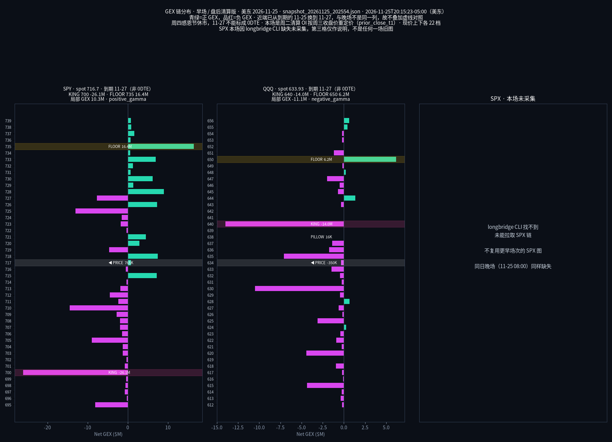
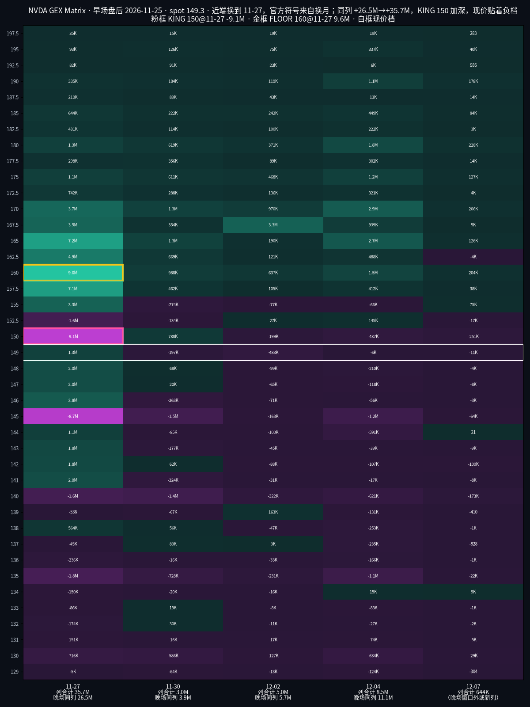
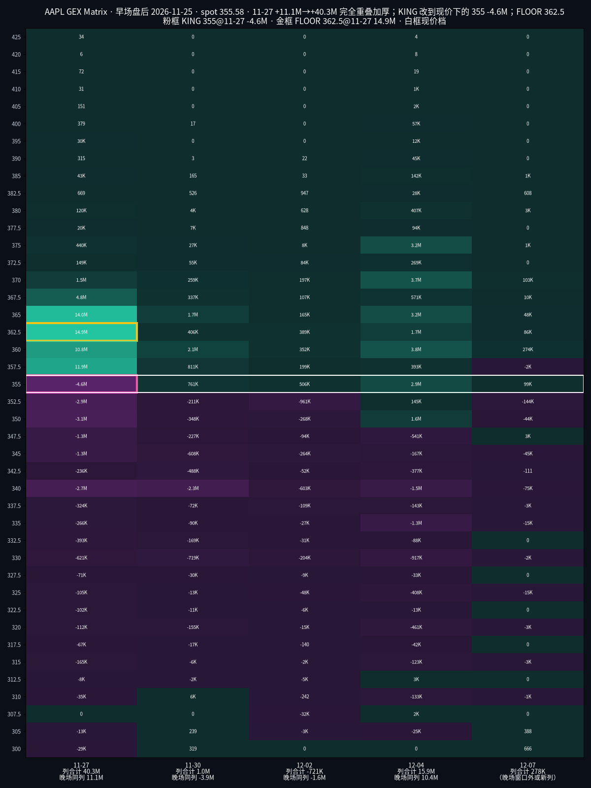
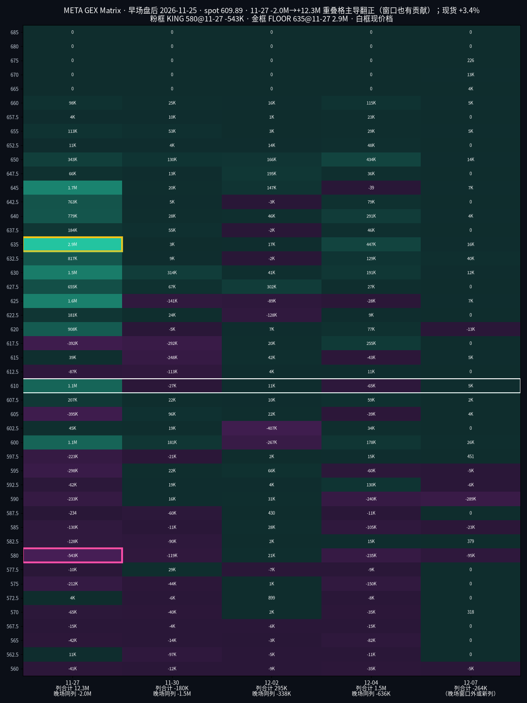
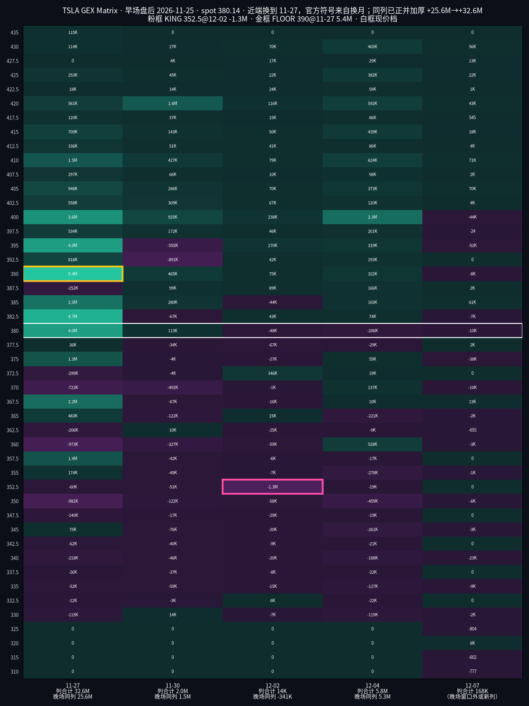
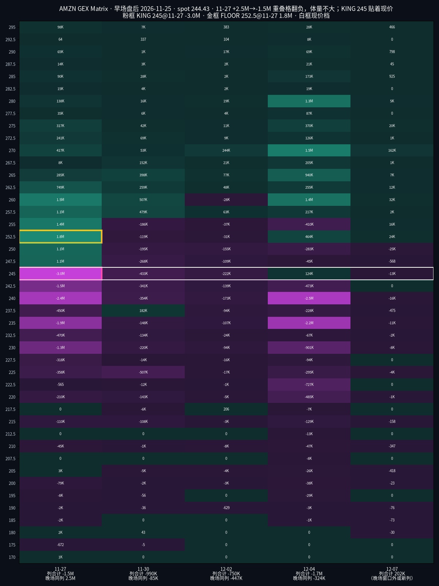

# GEX 早场（盘后清算版）日分析 · 美东交易日 2026-11-25（周三）20:15

**结论先行**
- 周三指数只小跌：SPY **718.78→716.70（-0.29%）**，QQQ **638.10→633.93（-0.65%）**。个股分化明显：NVDA **-3.91%**、MU **-4.53%**、AMZN **-3.12%**、GOOGL **-2.13%** 继续走弱，META 反而 **+3.40%**，AAPL **+0.43%**，SPCX **+1.30%**、COIN **+1.34%**。不要把指数的小跌和成长股、半导体混读。
- 指数近端已从到期的 **11-25** 换到 **11-27**（JSON `kind=nearest`，本文按实际到期日写，**不标成 0DTE**）。周四（11-26）是感恩节、美股休市，所以跳过了周四到期，周五才是下一根常规交易日，也才是 11-27 的 0DTE。这是换月，不是同一列的仓位结论。
- `oi_inventory=prior_close_t1`：本场仍是**周二清算 OI**按周三收盘价重定价，再叠窗口滑动。周三清算 OI 要等到周五 08:00（若假日周拉链照常跑）。自动摘要里 NVDA / TSLA / AAPL 的「强力翻正」，主要是近端从到期的负日列换到本来就已经为正的周五周列，**不能当成同列翻正**。
- 新列上：SPY 局部 **+6.0M→+10.3M**，官方体制仍是 **positive_gamma**，但可见列净额是 **-23.0M**（到期的 11-25 列是 -67.8M）。官方 FLOOR 跳到现价上方 18 点的 **735 +16.4M**，那是头顶正墙，不是脚下支撑；KING 仍在 **700 -26.1M**（现价下约 17 点），近处还有 **710 -14.5M**、**725 -13.0M**。不要只把官方正 gamma / 局部翻正当头条。
- QQQ 更清楚：局部 **+5.7M→-11.1M**，体制 **positive_gamma→negative_gamma**，可见列净额 **-50.8M**。这是新的 11-27 列本身偏负，不是把晚场那条 0DTE「盘中修回去了」。KING **640 -14.0M** 在收盘上约 6 点，现价附近 630 / 635 / 633 也是负档，FLOOR **650 +6.2M** 远在上方约 16 点。
- **SPX 连续第五场缺失**（从周一盘后起），错误仍是「找不到 longbridge CLI」。拉链跑在 `win-host`。矩阵 29/29、SPY/QQQ 各 102/102 完整，`collection.ok=false` 只因 SPX。不复用任何一场旧 SPX 图。

## 1) 数据与新鲜度
- 场次：早场 / 盘后清算版。目标时刻美东 2026-11-25 20:15（北京 2026-11-26 09:15）。
- 读取文件：仓库 `wikiTang-code/whop-wechat-bridge` 分支 `feat/chg064-offline` 的 `data/gex/20261125/snapshot_20261125_202554.json`（目录内 `latest.json` 带有 `preopen` / `oi_inventory` 等元数据；不要用仓库根上可能过期的 latest 指针）。同日晚场对照是 `data/gex/20261125/snapshot_20261125_081032.json`。
- 生成时间 `generated_at`：**2026-11-25T20:15:23-05:00**（北京 2026-11-26 09:15:23）。拉链 20:10 ET 唤醒，目标 20:15，实际 20:15:21 开始拉链，**20:25:54 ET** 完成（北京 09:25:54），完成窗口 20:35–20:40、截止 20:40，`deadline_status=on_time`，`late=false`，`pulled_before_chain_target=false`。`spot_session=closed_or_extended`，`host=win-host`，`oi_inventory=prior_close_t1`，`oi_as_of=yesterday_close`。归档推送时间为北京 **09:25:54**（提交 `d9177ad`）。相对本场目标时刻，数据新鲜、准时。
- 采集：富途 OpenD `us_option=LV1`。SPY/QQQ 各 102/102，矩阵 29/29。SPX 失败：`找不到 longbridge CLI`（安装提示仍是 Windows 的 `install.ps1`，与本场跑在 win-host 相符）。不把 `collection.ok=false` 当成总失败，只标明 SPX 缺席。
- 对照：同日晚场已出的完整分析，基准快照是 `data/gex/20261125/snapshot_20261125_081032.json`（`generated_at` 2026-11-25T08:00:01-05:00，北京 21:00:01；报告 `analysis_evening_diff.md`）。当时 11-25 已是 0DTE，且是第一份周二清算 OI，现货仍是周二收盘。本场 11-25 已经到期离开，新列是 11-27。快照里的 `change_pct` 是相对周二收盘，与用两场现货算出的涨跌一致。

## 2) 差异总览（核心）

### 指数近端（到期 2026-11-27，已换月；晚场是到期的 11-25 列）

| 标的 | 现货 | KING | FLOOR | 局部 GEX | 可见列合计（正/负/净） | 体制 |
|---|---|---|---|---|---|---|
| SPY | **716.70（-0.29%）** | **700 -26.1M**（晚场到期列同样是 700，当时 -15.6M） | **735 +16.4M**（晚场到期列 702 +7.9M，当时在现价下方 16.8 点） | **+10.3M**（晚场到期列 +6.0M） | 正 **+86.9M** / 负 **-109.8M** / 净 **-23.0M**（晚场到期列 +44.4M / -112.3M / -67.8M；新列 51 档，692–742） | 仍是 **positive_gamma**（新列；可见列净额仍为负） |
| QQQ | **633.93（-0.65%）** | **640 -14.0M**（晚场到期列 619 -11.0M） | **650 +6.2M**（晚场到期列 638 +2.6M，当时几乎就在现价） | **-11.1M**（晚场到期列 +5.7M） | 正 **+11.1M** / 负 **-61.9M** / 净 **-50.8M**（晚场到期列 +19.7M / -64.1M / -44.4M；新列 51 档，609–659） | **positive_gamma→negative_gamma**（新列） |
| SPX | 本场缺失 | — | — | — | 晚场同样缺失，没有可对照的阶梯 | — |

分解（换月，地理重叠只作位置参考，不当成同一列仓位变化）：
- SPY 新列 51 档净额 **-23.0M**，负档 28 对正档 23，官方正 gamma 只描述局部（+10.3M），不描述整段可见链。现价附近其实有一薄层正档：收盘下 1.7 点 **715 +7.2M**、收盘上 1.3 点 **718 +7.5M**、现价档 717 只有 +0.76M。官方 FLOOR 是远在上方 18.3 点的 **735 +16.4M**，再往上还有 **740 +6.8M**；这是头顶正墙，不能写成脚下支撑。晚场那块还在现价下方的 702 +7.9M，已经随 11-25 到期离开。真正要盯的洞是下沿 KING **700 -26.1M**（比晚场更深），以及更近的 **710 -14.5M**（现价下 6.7 点）和头顶的 **725 -13.0M**、**727 -7.7M**。
- QQQ 新列净额 **-50.8M**，比到期列还更负一点。现价附近几乎没有正档：630 -10.5M（下 3.9 点）、635 -7.1M（上 1.1 点）、633 -1.4M，638 只剩 +16k 的薄枕。KING **640 -14.0M** 在收盘上方约 6 点，属于头顶负带，不是下方支撑。FLOOR **650 +6.2M** 远在上方 16 点，近处最大的正档也就 **644 +1.3M**。下沿 620 / 615 / 625 仍是成片负墙。官方体制翻负，和这条阶梯是对得上的。
- 两场都没有 SPX，波动哥点位这一节对不到墙。

### 矩阵重点（同列对比，已复核官方合计，并拆成重叠格 vs 窗口滑动）

自动摘要把 NVDA / TSLA / AAPL / META 都标成「强力翻正」，其中前三只主要是近端换月。下面按同一到期日的重叠格来看。

| 标的 | 现货 | 近端列（同到期） | KING | FLOOR | 备注 |
|---|---|---|---|---|---|
| NVDA | 155.38→**149.30（-3.91%）** | 近端从到期的 11-25 **-31.8M** 换到 11-27。同列 11-27 **+26.5M→+35.7M**（重叠 38 档 +26.0M→+36.6M，窗口只有 1.4M），本来就已经为正，不是翻正 | 仍是 **150**，但到期日换成 11-27：**-6.5M→-9.1M**，现已贴在收盘上方 0.70 点 | **160@11-27 +9.6M**（晚场同列 157.5 +6.0M；160 由 +4.6M 加厚，现价上 10.7 点） | 145 也从 -7.1M 加深到 -8.7M；165 / 157.5 继续加厚。周五列整体更正，但现价就坐在 150 这条更深的负 KING 边上。11-30 / 12-02 / 12-04 官方变薄主要是窗口下移 |
| TSLA | 384.68→**380.14（-1.18%）** | 近端从到期的 11-25 **-2.6M** 换到 11-27。同列 11-27 **+25.6M→+32.6M**（重叠 +25.5M→+32.8M，窗口可忽略），同样是已经为正再加厚 | 官方 KING 换到较远的 **352.5@12-02 -1.3M**（晚场是到期列 375 -2.1M） | 仍是 **390@11-27 +3.9M→+5.4M**（现价上 9.9 点） | 现价档 380 +4.0M，近处 382.5 +4.7M。不要把官方近端符号当成由负翻正 |
| AAPL | 354.07→**355.58（+0.43%）** | 近端从到期的 11-25 **-10.0M** 换到 11-27。同列 11-27 **+11.1M→+40.3M**，41 档完全重叠、窗口为 0，是真实加厚，不是翻正 | **355@11-27 -4.6M**（由 -1.1M 加深，现价下 0.58 点） | **362.5@11-27 +14.9M**（由 365 +9.7M 换到更近的 362.5，365 也加到 +14.0M） | 360 / 357.5 同步加厚，340 从 -8.1M 收到 -2.7M。现价上方正墙明显变厚，但脚下 355 这条负口袋更深了。11-30 也是完全重叠，从 -3.9M 翻到 +1.0M，体量中等。这是连续加厚，不是自动摘要写的「由负翻正」 |
| META | 589.82→**609.89（+3.40%）** | 近端从到期的 11-25 **-4.5M** 换到 11-27。同列 11-27 **-2.0M→+12.3M**：重叠 33 档 **-0.54M→+9.2M**，窗口约 4.5M（滑出下方负档、滑入上方正档）。重叠格主导的真实翻正，窗口也有贡献，不要把官方 +12.3M 全部写成仓位翻新 | 仍是 **580@11-27**，从 -1.2M 收到 **-0.54M**，现已在现价下约 30 点 | 仍是 **635@11-27 +0.85M→+2.9M**（现价上 25 点） | 现价附近 610 +1.1M、600 +1.1M，正档主要铺在 620–645。这是本场少数够格单独说「周五列翻正」的名字，而且现货也涨了 |
| AMZN | 252.29→**244.43（-3.12%）** | 近端从到期的 11-25 **-10.9M** 换到 11-27。同列 11-27 **+2.5M→-1.5M**，38 档几乎完全重叠（窗口可忽略），是真实翻负，但体量不大，不宜写成「强力翻负」 | **245@11-27 -2.2M→-3.0M**，现已贴在收盘上方 0.57 点 | **252.5@11-27 +1.8M**（晚场同列 260 +2.4M；260 收到 +1.5M） | 240 / 235 / 242.5 仍是负档。上方正档在变薄 |
| SOXL | 32.60→**32.02（-1.78%）** | 11-27 **+3.9M→+2.3M**（重叠 36 档 +4.0M→+2.3M，几乎无窗口），仍为正，只是减薄 | 仍是 **30@11-27 -2.2M→-2.7M**（现价下 2.0 点） | 仍是 **37@11-27 +2.2M**（现价上约 5 点） | 晚场刚确认过的 11-27 翻正还在，没有再翻回去。12-18 仍小幅为负 |
| SOXX | 128.62→**127.98（-0.50%）** | 11-27 **-3.0M→-3.3M**（重叠主导，变化很小） | 仍是 **125@12-18 -7.2M→-6.8M**（现价下约 3 点） | 官方换成 **130@11-27 +1.2M**（晚场是 145@12-18 +0.77M；145 已不在最近的官方 FLOOR 上） | 12-18 仍大幅为负（-21.7M→-21.6M）。近端结构没有大变 |
| SPCX | 125.81→**127.44（+1.30%）** | 近端从到期的 11-25 **-10.7M** 换到 11-27。同列 11-27 **-7.7M→-6.1M**（重叠收窄 1.6M，几乎无窗口），仍为负，只是略收 | 仍是 **120@11-27 -3.4M→-2.8M**（现价下 7.4 点） | 仍是 **137@12-04 +2.9M→+3.1M** | 不要把官方近端从 -10.7M 收到 -6.1M 写成翻正。11-30 由 +0.50M 加到 +1.3M，12-04 仍负但收窄（-4.4M→-3.1M） |
| MU | 629.79→**601.25（-4.53%）** | 近端从到期的 11-25 **-4.5M** 换到 11-27。同列官方 **-3.8M→-5.3M**，但重叠 29 档是 **-3.9M→-3.7M**（还略收窄）；官方变差主要是窗口下移滑入 -1.6M | **600@11-27 -2.7M**（晚场是到期列 600@11-25 -2.6M；现已贴在收盘下 1.25 点） | 仍是 **630@11-27 +1.6M→+2.2M**，现已在现价上方 28.8 点，不再贴着现价 | 这是价格下移带出来的列符号变化，不要把官方加深写成重叠格翻新 |
| MSFT | 496.13→**489.93（-1.25%）** | 近端从到期的 11-25 **-15.2M** 换到 11-27。同列 11-27 **-11.8M→-10.1M**（重叠收窄 1.8M），仍是大负列 | 仍是 **490@11-27 -5.6M→-8.9M**，现已贴着收盘（上 0.07 点） | **505@11-27 +1.5M**（晚场 510 +1.6M） | 列合计略收，但贴身的 490 负 KING 更深了。继续按负近端处理 |
| GOOGL | 279.05→**273.10（-2.13%）** | 近端从到期的 11-25 **-8.7M** 换到 11-27。同列 11-27 **-2.3M→-4.0M**（重叠 38 档 -2.4M→-4.0M，窗口可忽略），仍负并加深 | **275@11-27 -4.6M**（晚场是到期列 267.5 -4.4M；275 现已在收盘上 1.9 点） | 仍是 **290@11-27 +3.4M→+2.4M** | 周五列没有翻正 |
| COIN | 102.35→**103.72（+1.34%）** | 11-27 **-1.3M→-3.1M**（重叠主导，加深 1.8M） | 官方 KING 换到 **101@11-27 -1.5M**（现价下 2.7 点；晚场是 110@12-18） | 仍是 **109@11-27 +1.7M→+2.2M** | 现货小涨，近端列反而更深负 |
| NBIS | 87.31→**84.99（-2.66%）** | 11-27 官方 **+24.3k→-1.3M**。重叠格晚场其实已接近 0（-45k）→**-1.3M**。这是从「接近零的正印」走回小额负列，不宜写成强力翻负；晚场那次 +24.3k 本来也不该标成强力翻正 | **80@11-27 -1.0M** | **100@11-27 +0.75M** | 体量仍小，不单独当头条 |

其余未展开的：INTC 11-27 仍负但重叠格收窄（-5.5M→-2.4M），不过 KING 换到现价上方的 **56 -6.6M**，FLOOR 变成紧挨着的 **57 +6.1M**，近处正负挤在一起；CIFR 11-27 仍正但略薄（+3.2M→+3.0M）；IREN 近端更深负（-2.2M→-2.7M）。

## 3) 附图
- 指数链：SPY / QQQ 并排，青绿正 GEX、品红负 GEX，标出现价、KING、FLOOR。第三格是 SPX 缺失说明，**不是**任何一场旧图。本场图按早场盘后快照新绘。因为近端已经换到 11-27，与晚场 11-25 列不是同一到期，**不叠加虚线对照**。到期日按 11-27 标注，不写成 0DTE。
- 个股到期矩阵（结构变化大的才附）：NVDA（官方翻正来自换月，周五列仍正但 150 负 KING 贴着现价）、AAPL（11-27 大幅加厚，355 负口袋加深）、META（11-27 重叠格主导翻正，现货 +3.4%）、TSLA（官方翻正来自换月，周五列已正并加厚）、AMZN（11-27 重叠格翻负，体量不大，245 负 KING 贴着现价）。列头附晚场同列合计。

## 4) 对照说明（再压缩一句）
同日晚场是 11-25 的第一份周二清算 OI，指数局部已经偏正，但可见列净额仍负，SPOT 还是周二收盘。本场是换月后的 11-27 新列，再加上同一份周二 OI 按周三收盘价重定价。SPY 官方体制仍正、QQQ 官方体制翻负，描述的都是这条新列在新现货上的样子，不是把晚场那条 0DTE「盘中修回去了」。个股里，META 的周五列重叠格翻正、AAPL 周五列继续加厚、AMZN 周五列小额翻负，值得单独看；NVDA / TSLA / AAPL 自动摘要里的「强力翻正」先当成换月。

## 6) 波动哥点位 vs GEX
点位来源：Discord stockrocks「🌟波动哥」。撰写时今日 Discord 例行（窗口 11-25 09:00 至 11-26 09:00 北京）尚未见到新导出；本地最新完整窗口仍是 `/workspace/discord-daily-20261125/`，覆盖 11-24 09:00 至 11-25 09:00 北京。该窗口内最新一份五点位是 **2026-11-25 06:01:29（北京）**、针对 **11 月 25 日**盘中的标注（06:01:48 又重复贴了同一张表）。若今日 Discord 例行随后给出新点位，以新导出为准。

五点（2026-11-25 开盘前，未在此后已见导出中更新）：**7333.7 / 7289.4 / 7223.9 / 7166.0 / 7099.3**。同一条说明里还写「明天波动会放大，上下应该有 100 点空间，伽马为负」。这些是对周三盘中的表述，不是对周四休市或周五开盘的新点位。

本场 **SPX 链缺失**，无法列出这些行权价（或最近档）上的 GEX 金额与正负，也不能量相对本场 SPX 现价的距离。不复用更早的 SPX 阶梯来填这张表。按既有约定，用 SPX 7376.86 = SPXL 246.75 的 3 倍线性关系，只换算对应 SPXL 价格（用户持有 SPXL），不做吻合判断：

| 波动哥 SPX 点位（11-25 开盘前） | 对应 SPXL（线性） | 本场 SPX 链 |
|---|---|---|
| 7333.7 | 245.31 | 缺失，对不到 |
| 7289.4 | 243.82 | 缺失，对不到 |
| 7223.9 | 241.63 | 缺失，对不到 |
| 7166.0 | 239.70 | 缺失，对不到 |
| 7099.3 | 237.47 | 缺失，对不到 |

本场没有 SPX 现货，只能提醒：周三 SPY 收在 716.70，QQQ 收在 633.93。若只用十分位把「下面」7166 粗对到 SPY 邻域，收盘就落在这条线下附近，但这不是 SPX 链上的墙，也不表示点位被验证。在没有 SPX 阶梯之前，停在「对不到墙」。

## 7) 可执行观察（非荐股）
1. 先记住近端已经换到 **11-27**，而且周四休市，这条列到周五才是 0DTE。晚场 11-25 的 702 / 638 那些墙已经到期离开。开盘后若还拿到期列当锚，位置是错的。这是周二 OI 在周三收盘价上的结构，周五 08:00 才会第一次打上周三清算 OI。
2. SPY：不要被官方正 gamma 和局部 +10.3M 带走。可见列净额仍是 **-23.0M**。先看收盘夹在 **715 +7.2M** 和 **718 +7.5M** 这一小段正档，以及下沿 **710 / 700** 和头顶 **725 / 735**。735 是远在上方的官方 FLOOR，不是脚下支撑。
3. QQQ：新列官方已经是负 gamma，局部 -11.1M，可见列净额 **-50.8M**。先看现价下方的 **630 -10.5M**、头顶的 KING **640 -14.0M**，以及远处的 650 正档。现价附近几乎没有正墙。
4. 个股不要跟着自动摘要的「强力翻正」走。NVDA / TSLA / AAPL 的官方近端符号主要是换月；AAPL 周五列倒是在继续加厚，但 355 负口袋更深了。META 的 11-27 才是重叠格主导的翻正。AMZN 周五列小额翻负，245 贴着现价。SOXL 周五列仍正，只是减薄；SOXX / SPCX / MSFT 近端仍负。
5. SPX 已连续五场在 `win-host` 上因 longbridge CLI 缺失而缺席。波动哥点位这一节继续只能记录「对不到」。要恢复对照，需要在实际拉链主机上修好 CLI，而不是回看旧图。周四休市，下一场常规交易是周五。

---
报告基于 `snapshot_20261125_202554.json` 与晚场 `snapshot_20261125_081032.json` 自行重算列合计与重叠格，不直接采用自动摘要的「强力翻正」表述。结构快照不是预测，不构成投资建议。
