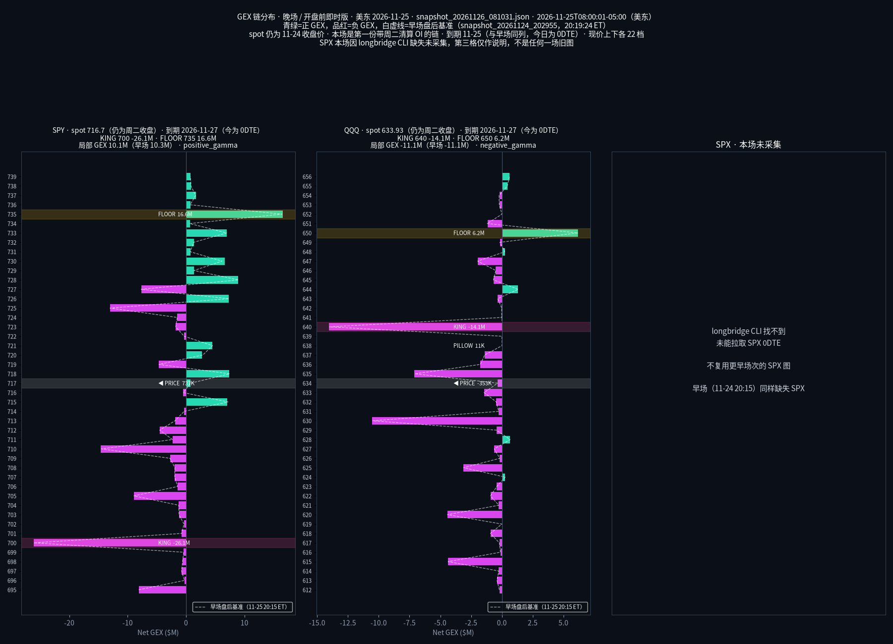

# GEX 晚场（开盘前即时版）日分析 · 美东 2026-11-26（周四，感恩节休市）08:00

**结论先行：晚场相对早场无显著漂移。**
- 感恩节美股休市，本场没有 09:30 ET / 北京 22:30 的常规开盘。拉链仍在 `win-host` 准时跑完，写出了新的 08:00 快照，但现货全部仍是周三收盘（SPY **716.70**、QQQ **633.93**），近端仍是 **11-27**（`kind=nearest`，**不标成 0DTE**；周五才是下一根常规交易日，也才是这根列的 0DTE）。
- `oi_inventory` 仍是 `prior_close_t1`，`oi_as_of=yesterday_close`。目录内 `latest.json` 写明：这批仍是收盘 T+1 库存，**不是新的 OI 打印**。与早场盘后是同一份周二清算 OI、同一套周三收盘价。周三清算 OI 按早场判断，要等到周五 08:00（若假日周拉链照常跑）。不要把本场当成「第一份周三清算 OI」。
- 指数与 29 只矩阵标的：KING / FLOOR 行权价全部未改，近端没有换月，可见窗口完全重叠、没有滑动，没有官方或重算的近端符号翻转。SPY 可见列净额 **-23.0M→-22.8M**（Δ +201k），局部 **+10.3M→+10.1M**，体制仍是 **positive_gamma**；QQQ **-50.8M→-50.9M**（Δ -106k），局部 **-11.1M** 未变，体制仍是 **negative_gamma**。个股近端官方合计的变动都在十几万到二十几万量级（如 NVDA +35.7M→+35.9M，AAPL +40.3M→+40.1M），属于重定价噪声，不是结构重构。
- **SPX 连续第六场缺失**（从周一盘后起），错误仍是「找不到 longbridge CLI」。矩阵 29/29、SPY/QQQ 各 102/102 完整，`collection.ok=false` 只因 SPX。不复用任何一场旧 SPX 图。

## 1) 数据与新鲜度
- 场次：晚场 / 开盘前即时版。目标时刻美东 2026-11-26 08:00（北京 21:00）。今日是感恩节、美股休市，**不存在**北京 22:30（美东 09:30）开盘；这份快照对 08:00 拉链是准时的，但不能按「开盘前 80 分钟」来读。下一根常规交易是周五 11-27。
- 读取文件：仓库 `wikiTang-code/whop-wechat-bridge` 分支 `feat/chg064-offline` 的 `data/gex/20261126/snapshot_20261126_081031.json`（目录内 `latest.json` 带有 `preopen` / `oi_inventory` 等元数据；归档 snapshot 本身略瘦，不要用仓库根上可能过期的 latest 指针）。
- 对照早场：不在 20261126 目录里，而在盘后目录 `data/gex/20261125/snapshot_20261125_202554.json`（`generated_at` 2026-11-25T20:15:23-05:00，北京 11-26 09:15:23；报告 `analysis_morning_postclose.md`）。那是本轮北京日历里已经出过的完整早场分析，也是正确的盘后基准。
- 生成时间 `generated_at`：**2026-11-26T08:00:01-05:00**（北京 21:00:01）。拉链 08:00:00 ET 开始，**08:10:31 ET** 完成（北京 21:10:31），截止 08:25、完成窗口 08:20–08:25，`deadline_status=on_time`，`late=false`，`spot_session=premarket`（假日标签，现货未变），`host=win-host`，`oi_inventory=prior_close_t1`。归档推送时间为北京 **21:10:31**（提交 `a93f2fc`）。
- 采集：富途 OpenD `us_option=LV1`。SPY/QQQ 各 102/102，矩阵 29/29。SPX 失败：`找不到 longbridge CLI`（安装提示仍是 Windows 的 `install.ps1`，与本场跑在 win-host 相符）。
- 快照里的 `change_pct` 仍是相对周二收盘，不是隔夜变动；下面一律按计算得到的 **0.00%** 来写现货。

## 2) 差异总览（核心）
未换月。指数近端仍是 11-27，与早场同一列、同一窗口（SPY 51 档 692–742，QQQ 51 档 609–659，一档都没滑走）。

| 标的 | 现货 | KING | FLOOR | 局部 GEX | 可见列合计（正/负/净） | 体制 |
|---|---|---|---|---|---|---|
| SPY | 716.70（未变） | 仍是 **700 -26.1M** | 仍是 **735 +16.6M**（早场 +16.4M；仍在现价上方 18.3 点，是头顶正墙，不是脚下支撑） | **+10.1M**（早场 +10.3M） | 正 **+87.4M** / 负 **-110.2M** / 净 **-22.8M**（早场 +86.9M / -109.8M / -23.0M） | 仍是 **positive_gamma**（局部仍正，可见列净额仍负） |
| QQQ | 633.93（未变） | 仍是 **640 -14.1M**（早场 -14.0M；仍在现价上方约 6 点） | 仍是 **650 +6.2M**（现价上方约 16 点） | **-11.1M**（未变） | 正 **+11.1M** / 负 **-62.1M** / 净 **-50.9M**（早场 +11.1M / -61.9M / -50.8M） | 仍是 **negative_gamma** |
| SPX | 本场缺失 | — | — | — | 早场同样缺失，没有可对照的阶梯 | — |

近处结构也还在原位：SPY 收盘仍夹在 **715 +7.1M** 和 **718 +7.4M** 这一薄层正档之间，下沿 **710 -14.6M**、头顶 **725 -13.0M** 几乎未动；QQQ 现价附近仍是 630 / 635 / 633 负档，638 只剩约 +11k 的薄枕。

矩阵 29 只现货全部未变，KING / FLOOR 行权价与到期日全部未改，近端列没有换月或翻转。未变的一句带过：NVDA 11-27 仍约 +36M、KING 仍是贴着现价的 150 负档；TSLA / AAPL / META 周五列仍正；SOXL 周五列仍正；SOXX / SPCX / MSFT / AMZN / MU / COIN 近端仍负。不另附个股矩阵图。

## 3) 附图
指数链按本场晚场快照新绘，不复用早场那张图。青绿正 GEX、品红负 GEX，标出现价、KING、FLOOR；白虚线是早场盘后基准，几乎与本场重合。第三格是 SPX 缺失说明，**不是**任何一场旧图。到期日按 11-27 标注，不写成 0DTE。因结构无显著变化，不附个股矩阵。

## 4) 可能含义与观察短清单（非荐股）
本场不是盘前漂移，也不是 Gamma 结构重构，只是假日里同一份周二清算 OI 的再打印。`spot_session=premarket` 在感恩节 08:00 并不表示今天还有盘前交易可改墙；现货锁在周三收盘。自动摘要仍按常规开盘前口吻写「限价单 / 北京 12:00 开闸」，今天用不上。

1. 记住今天休市。下一根常规交易是周五，11-27 到那时才是 0DTE。墙位仍按早场那份读：SPY 官方正 gamma 与可见列净额 **-23M**、头顶 735 正 FLOOR 并存；QQQ 官方已是负 gamma，列净额约 **-51M**，KING 640 在现价上方。
2. 真正可能改结构的下一场，是周五 08:00（若拉链照常跑）的第一份周三清算 OI，不要把本场数字提前当成那一份。
3. SPX 已连续六场在 `win-host` 上因 longbridge CLI 缺失而缺席。要恢复对照，需要在实际拉链主机上修好 CLI，而不是回看旧图。

---
报告基于 `snapshot_20261126_081031.json` 与早场 `snapshot_20261125_202554.json` 自行重算列合计与重叠格。结构快照不是预测，不构成投资建议。
