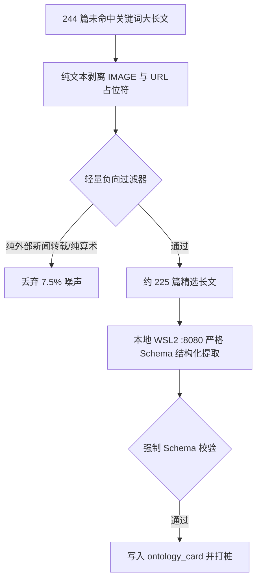

# 060 — 244 篇未覆盖大长文分层抽样审计报告 (DEBT-019 破局前置)

> **审计时间**：2026-10-20  
> **审计对象**：赵哥（`xiaozhaolucky`）纯文本字数 ≥ 100 且未命中原 25 个死板关键词的发言底池（N=244 篇）  
> **抽样方案**：按时间轴等距抽取 40 篇样本（跨度 2025-10 至 2026-10），逐篇进行客观价值打标。

---

## 1. 核心审计结论与密度分布

| 价值等级 | 核心特征定义 | 抽样数 | 占比 | 全池预估容量 (N=244) |
|---|---|:---:|:---:|:---:|
| **A 类：高价值战法/心法** | 含具体标的买卖点、日历波段节奏、宏观传导、仓位流转、逆商心理 | **23** | **57.5%** | **~140 篇** |
| **B 类：中等参考价值** | 板块轮动规律、财报事件排期、个股基本面与投资映射事实 | **14** | **35.0%** | **~85 篇** |
| **C 类：低价值/噪声** | 纯地缘新闻转载、点位算术草稿、无标的琐碎互动 | **3** | **7.5%** | **~19 篇** |
| **总计** | — | **40** | **100%** | **244 篇** |

> 📌 **关键结论**：  
> 1. **有效信息密度高达 92.5%**（A 类 + B 类），远高于此前担心的“充斥情绪碎念”；  
> 2. **噪声率仅 7.5%**，且特征高度单一（外部快讯转载、纯算术草稿），可通过极轻量负向过滤器精准剔除；  
> 3. 这 244 篇绝非可有可无的废话，而是包含冬令时日内分时规律、加密币反弹轮动顺序、SOXS/SOXL 双开对冲等系统急需的策略本体！

---

## 2. 典型样本穿透展示

### 2.1 A 类高价值战法样本 (代表性案例)
* **样本 5 (2025-11-05 · 日内分时与时间窗口战法)**：  
  `规律性的几个总结：盘前冬令时9点半涨幅是高开涨的 10点半 11点 11点半 7姐妹和明星股价格一路下滑...`  
  *【价值】系统极度缺乏的冬令时日内分时高低点滑落窗口统计。*
* **样本 7 (2025-11-21 · 标的点位与分批加仓时机)**：  
  `周五盘前低点价格可以分2次加的点 一次盘前低点附近 一次盘中结算put的时候 tsll 15.6 rklb 38...`  
  *【价值】具体标的点位与结算周期共振加仓时机。*
* **样本 31 (2026-06-03 · 多空对冲双开战法)**：  
  `soxs 里面 avgo跌幅大会影响他涨幅 avgo反弹多也要注意出剩下的 明天盘中要看回调是不是持续 这样 soxs和soxl就有双开的机会 今天高点先开空 然后等盘中数据再看什么位置开多...`  
  *【价值】SOXL/SOXS 衍生多空对冲与成份股 AVGO 领先指标战法。*
* **样本 37 (2026-08-20 · 仓位动态换仓与止盈做T)**：  
  `conl在政策利好下续涨了16% 盘前5.4出掉了4.85剩下一半死拿的仓位 准备后面btc继续强势的话coin先做正股 急跌在开始继续conl的分批低吸...`  
  *【价值】正股与 2x 杠杆 ETF 之间的动态轮换与波段止盈规则。*

### 2.2 C 类噪声样本 (负向过滤靶心)
* **样本 25 (2026-04-13 · 纯新闻转载)**：`伊朗海军已葬身海底，被彻底摧毁 —— 共计 158 艘舰船...`
* **样本 39 (2026-09-03 · 算术草稿)**：`7633+60=7693 7693+60=7753 一直要实行提前预判和提前计算...`

---

## 3. 稳健落地过滤管道设计

