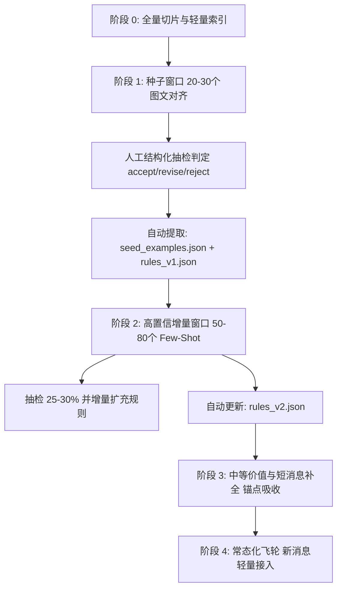
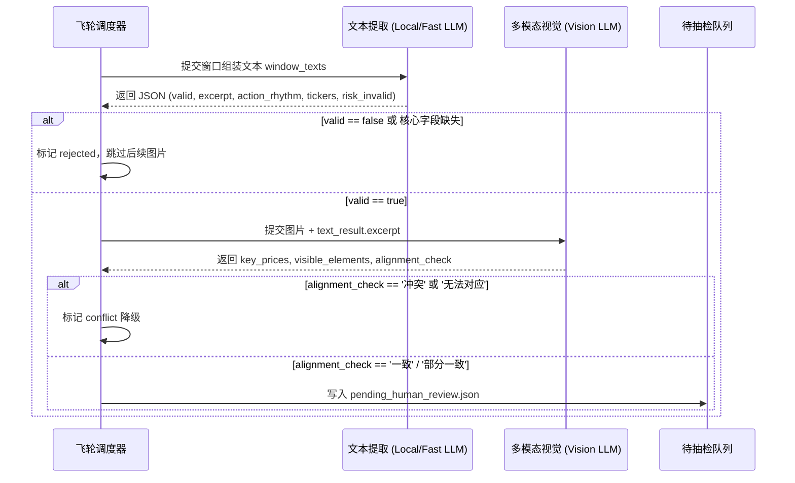

# 061 — 全量分步飞轮知识蒸馏与图文对齐规范 (Flywheel Multimodal Spec)

> **设计基准**：2026-10-20 人机协同共识拍板方案  
> **核心哲学**：不贪多盲扫，按窗口切片推进；图文互证对齐；每圈只吃最高置信子集，自动产出机器可读规则反哺下一圈。

---

## 1. 核心架构与飞轮四阶段

### 1.1 四大阶段核心指标

| 阶段 | 核心任务 | 输入规模 | 抽检比例 | 产出物 |
|---|---|---|:---:|---|
| **阶段 0** | 全量轻量索引与切片成组 | 1.9万发言 + 663张真图 | 0% | 消息级索引 + 时间窗口切片视图 |
| **阶段 1** | 种子高价值窗口跑通（图文对齐） | 20–30 个「有图+长文」窗口 | 100% | 8–12 条 Few-Shot + `rules_v1.json` |
| **阶段 2** | 高置信增量批量提炼（Few-Shot驱动） | 50–80 个高相似度窗口 | 25–30% | 新增 40+ 有效窗口，规则库增量升级 |
| **阶段 3** | 中等价值池与短消息上下文吸纳 | 剩余长文 + 锚点邻近短消息 | 10–15% | 全面覆盖 B 类宏观与板块记忆 |
| **阶段 4** | 闭环固化与日常增量接入 | 盘中/每日新发言 | 仅低置信抽检 | 常态化轻量自动化接入通道 |

---

## 2. 种子窗口选取规则（阶段 1 门禁）

1. **有图 + 长文锚点**：窗口内包含真实有效图片（>15KB），且至少有 1 条纯文本 ≥100 字的复盘/口播；
2. **紧凑时间窗**：以锚点消息为中心，向前取 2 小时，向后取 6 小时（覆盖盘中波动与盘后完整复盘），跨日超 24 小时硬截断；
3. **标的聚焦**：窗口内涉及的核心标的数量在 1 ~ 5 个之间（优先 IREN, SOXL, SOXS, MU, CRWV, COHR, LITE, COIN, CONL, NBIS 等）；
4. **硬性排噪**：负向过滤纯外部新闻转载与纯算式草稿；
5. **时序优先**：优先选取近 3~6 个月的高清典型窗口。

---

## 3. 图文串联解析与对齐门禁协议

---

## 4. 机器可读的规则反哺协议 (Machine-Readable Feedback)

每阶段抽检完成后，代码必须自动更新三份核心资产文件：
1. `seed_examples.json`：存放用于 Few-Shot 的标准高纯度示例条目；
2. `rules_v*.json`：存放负向过滤正则、正向高频词、图文对齐判定规则；
3. `window_status.json`：所有窗口的处理流水、对齐状态与人工审校记录。
